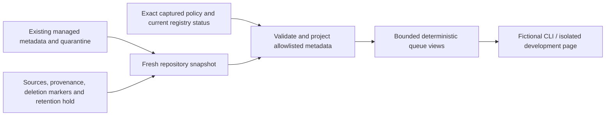

# Dayline — Initial Architecture Proposal

The long-term stack remains a proposal. Foundation 001's development milestone was previously accepted and merged, as confirmed by the owner; later regression and production checks are separate from that historical acceptance. Implementation notes below describe subsequent internal milestones.

## Suggested stack
- TypeScript web application, responsive accessible UI and progressive web app features.
- Server-side API and scheduled workers; no API secrets exposed to browsers.
- Postgres for source metadata, story evidence, editions, corrections, reader settings and entitlements.
- Object storage/CDN for pre-generated edition audio, artwork with verified rights, and approved media.
- Job queue with retries, idempotency keys, rate limits, audit events, and dead-letter handling.
- Stripe Checkout/Billing webhooks with server-verified entitlement changes.
- OpenAI speech integration via a narrowly scoped server adapter; pin only currently supported models after verification.

## Proposed pipeline
Approved/rights-cleared source ingestion -> deduplication and provenance -> evidence records -> AI draft -> verification and editorial holds -> approved edition snapshot -> web publication -> optional audio rendering -> cached audio delivery.

The edition script must be versioned and approved before any narrated asset is generated. Corrections must invalidate or replace affected narrated versions. No client-side key distribution and no per-play speech regeneration by default.

## Data integration contracts
- Treasury Debt to the Penny: report as-of date, total public debt outstanding, debt held by public, intragovernmental holdings; verify component arithmetic.
- NWS: forecast and observation as distinct datasets, station/source timestamp, geolocation selection and caching; alerts are a separate safety-sensitive stream.
- Markets: licensed display integration; do not scrape, rebroadcast, or imply real-time rights.
- News: licensed inputs and rights-aware original summaries, with explicit attribution and deep links.

Each panel must distinguish fetched_at from source_published_at / observation_time. Preserve last valid cache with stale indicators instead of fabricating new values.

## Threat and cost controls
- Environment-based secrets; least-privilege credentials.
- Request authentication, rate limiting, bot mitigation, data validation and output escaping.
- Subscription entitlements are granted only after verified Stripe server events.
- Cached shared speech assets for each approved edition/voice combination.
- User-requested individual-article audio requires per-account quotas and cost controls.
- API budget alerts plus application-enforced caps; never rely solely on budget notifications as a hard stop.
- Comprehensive logging without leaking secrets or unnecessary user data.

## Foundational verification
- Unit tests for formatting, stale-state rules, accounting invariants and tier entitlements.
- Integration tests with mocked NWS, Treasury, voice, and Stripe.
- Browser tests for mobile navigation, keyboard access, citation links, transcript fallback, and no cross-user account leakage.
- Explicit physical acceptance before merging.

## Foundation implementation notes

Treasury amounts are validated as decimal cents and reconciled with a five-cent tolerance using integer arithmetic. Official requests use an eight-second per-attempt timeout and at most three attempts for network failures, 429 and 5xx responses. NWS requires an identifying User-Agent with contact email. Process-local caches expose retrieval timestamps and stale flags; they do not survive restarts or coordinate across instances. No source failure generates substitute measurements.

## DL-003A internal newsroom

`src/newsroom` provides an internal domain service and a local JSON repository; it is not attached to HTTP or the homepage. Fixtures describe imaginary events only. Sources retain canonical URL, rights metadata, verification and original-report identity; tracking parameters and fragments are removed for duplicate detection. Syndicated copies require an existing non-syndicated original and share its independence identity. The count depends on accurate classification and does not prove editorial independence. Headline similarity returns candidates for human review and never merges stories.

The service permits INGESTED → CLUSTERED → DRAFT → NEEDS_REVIEW → APPROVED → PUBLISHED, with explicit hold and rejection transitions and PUBLISHED → CORRECTION_REQUIRED → DRAFT for corrections. Rejected stories cannot silently resume. Approval requires supported, verified claims and records a reviewer label and exact revision; changing an approved story returns it to draft. Ordinary editorial changes append a revision and audit event. Claim verification requires at least one associated supporting source; reviewers remain responsible for assessing source trust and contradictions. Retention-redacted stories cannot be edited or transitioned, and a repository retention-review hold blocks new approval/publication.

The JSON repository serializes cooperating single-host writers with an exclusive lock directory and replaces a synced temporary file via rename. Snapshots are copies. Retention cleanup explicitly replaces affected revisions and approval/audit details with minimized procedural stubs; complete history is not immutable. This is not tamper-proof storage: trusted code or filesystem access can rewrite files; there is no production identity provider, system-wide authorization enforcement, inter-host locking, directory fsync guarantee, transactional database, automatic stale-lock recovery or production audit protection. The opt-in DL-005A facade adds the internal synthetic-session boundary described below; direct legacy reviewer strings remain assertions. After a crash, inspect any lock or temporary file before manual recovery. Internal status transitions do not publish articles to readers. Production authorization and unattended publication remain blocked until real identities, reviewed permissions, durable transactional storage and operational safeguards are separately implemented and approved.

## DL-003B provider boundary

`src/ingestion` separates provider request limits and metadata from newsroom records. GNews uses its documented v4 search response shape, is disabled unless explicitly enabled with a server-side key, and has bounded request size, pages, retries and timeouts. Its normalizer discards titles, descriptions, full text and images and marks provenance unknown. No live-provider runner exists, and the ingestion registry denies GNews regardless of adapter configuration. Never log the credential-bearing request URL.

### DL-003B-R1 policy and provenance controls

`ingestArticles` receives a `JsonRepository`, provider articles and `{ providerId, policyId }`; caller-provided policies and permission overrides are rejected. The private, frozen registry contains only `fictional-fixture` policies. Resolution requires an approved, complete policy with an evidence reference, version, effective date and expiry. Missing, unapproved, expired, revoked, superseded or mismatched policies deny ingestion. No real provider has an approved policy. Excerpts, full text and media are never persisted by this integration, and fixture permission fields authorize no real analysis, redistribution or AI service.

Every retained item captures the exact policy snapshot, retention time and deletion deadline. Retention is measured from the earlier of ingestion and original retrieval, capped by policy expiry; delayed ingestion cannot reset it. Revalidation compares the snapshot with its registered version; a later policy cannot expand existing permissions or extend retention. Fixed clocks and repository fault hooks exist for trusted tests and fixture composition, not request-supplied authorization.

Unknown or disputed provenance is retained only in metadata-only quarantine if the governing policy explicitly permits it; otherwise the item is discarded. Even provider-declared provenance requires an explicit recorded decision before an imported source becomes eligible. A decision includes classification, original-report identity when syndicated, actor assertion, timestamp, reason and evidence references. Contradictions with known provider provenance or prior resolved decisions are rejected. Syndication requires an identifiable, eligible primary or original report and shares its independence identity. Quarantine contributes neither independent-source counts nor approval evidence. Resolution keeps the original rights snapshot and retention deadline and creates an unverified source; it does not verify claims or authenticate a reviewer.

### Local transactions, migration and retention

Each ingested item uses one repository transaction for its source or quarantine record, provenance decision and outcome audit. Duplicate decisions are made under the same local lock. Rejected and duplicate attempts still produce counts and atomic procedural outcome events, without a source ID/hash that would create a separate identifying retention obligation. Dry runs apply the same decisions to an in-memory snapshot without writing. A failed storage transaction increments the failed count and commits neither a success record nor its outcome event. No network request runs under the repository lock. These local atomic replacements do not establish multi-host or production database guarantees.

Schema-1 through schema-6 repositories migrate to schema 7 in memory when read; reading alone does not rewrite the file. Schema 7 adds identity/session metadata, security events and authenticated-action receipts alongside existing schedules, editions and drafts. Migration preserves existing records and schema-3/4/5/6 retention-review flags; schema 1/2 starts under `retentionReviewRequired: true` because past removals cannot be established safely. No historical approval receives an authenticated receipt during migration. A new empty schema-7 repository starts with the flag false. The next successful transaction writes schema 7. Legacy source assertions are historical records, not retroactive registry approval; policy snapshots missing the audit-retention grant are unknown rather than upgraded. Direct `Newsroom.ingest` remains restricted to fictional `.test` sources with the exact rights label `fictional test fixture only` and IDs outside the provider-managed `url-` namespace. New provider imports use the registry and provenance controls above. Both ingestion paths and provenance resolution are blocked while retention review is required.

`cleanupRetention(repository, at, dryRun = true)` is manual; a dry run only reads and previews metadata candidates. Applying cleanup removes expired or ineligible managed metadata, quarantine, dependent managed syndicated copies and linked ingestion details in one transaction. It also detects identifying audit subjects with no governing managed source, quarantine or unexpired marker. Those audit orphans trigger the review hold and are replaced with non-identifying procedural stubs. Before scrubbing audit links, cleanup follows subject-to-story links as well as revision/evidence references to redact known historical copies, even when no metadata candidate remains. Every affected story version is replaced using a field whitelist: prose, evidence, source IDs, geography, cluster identity and original story ID are removed. A fresh random story ID consistently links the minimized versions, approvals and procedural audit events; actor labels are redacted. Unrelated lawful history remains unchanged. Retained procedural stubs do not preserve licensed prose. Redacted stories cannot enter the correction-to-draft path or any other edit/transition.

Deletion markers are linkable source identities, so they may remain only when the captured policy permits minimal audit and supplies a finite positive `auditRetentionDays`. The fixture grant is one day; `fictional-no-audit-v1` permits no marker and uses zero. Markers carry `expiresAt`; expired, invalid or old deadline-less markers and their linked audits are purged without renewal. Missing audit terms do not authorize a new grant. Cleanup sets a repository-wide `retentionReviewRequired` boolean when data is removed or historical retention concerns are found. This flag stores no source identity and blocks provider/legacy ingestion, provenance resolution and new approval/publication after markers disappear. There is no application operation to clear it.

Cleanup is logical deletion from the current JSON repository, not secure erasure or enforcement across backups, snapshots, fresh repositories, external copies or unlinked prose. It has no scheduler or reviewed release-from-hold procedure. `npm run retention:fixture` seeds a temporary fictional repository and previews cleanup; `npm run retention:fixture -- --apply-fixture` applies cleanup only to that temporary fixture. Neither accepts an existing repository path or live mode. The ingestion fixture defaults to dry run, reports counts and safe item indexes, and supports temporary writes with `--write-fixture`. Both runners use a fixed fictional clock, remove their temporary directories, create no stories and make no network requests. Real contracts, authenticated identity and authorization, external retention controls, production transactions and public publication remain separate blocked requirements. See [retention policy](RETENTION_POLICY.md) and [provider evaluation](NEWS_PROVIDER_EVALUATION.md).

## DL-003C internal editorial proposals

`src/editorial` separates model execution, deterministic output validation, advisory language checks and proposal review. The only supplied provider is a deterministic mock. A model runner bounds input/output bytes, attempts, concurrent work, proposals per run and estimated cost, with timeout/cancellation and sanitized failures. Estimated attempt reservations are development accounting, not paid usage or production billing enforcement. No real provider SDK, credential or network request is enabled.

Generation consumes a current `DRAFT` or `NEEDS_REVIEW` story's fictional evidence marked `VERIFIED`, with identifiable support and eligible managed metadata. Every referenced source must have an exact active policy snapshot explicitly permitting licensed excerpts, internal analysis and AI summarization. The registry's `fictional-ai-editorial-v1` grant applies only to invented fixtures; discovery or redistribution permission alone cannot authorize this use. Source verification flags remain unchanged, and a verified evidence flag is not an independent truth finding by this service.

Fixed system instructions and the versioned prompt template are separate from untrusted evidence. Output must match a strict extractive schema: factual claims and citations reproduce stored evidence, contradictions and uncertainties remain, and fact/analysis/uncertainty sections are distinguished. Analysis is limited to a fixed human-review sentence; quotations and unsupported changes to numbers or dates are rejected. Pattern-based neutrality suggestions are transparent human-review aids, without autonomous truth scoring or equal-weight requirements. Injection screening is heuristic and cannot establish complete immunity.

A proposal captures its story revision, source IDs, policy snapshot digests, model/prompt versions, generation and expiry times, usage estimates and suggestions. Its content is immutable through the service; regeneration creates another proposal. Review checks the expected proposal version and current captured story revision, with restricted states and audited, explicitly unauthenticated actor assertions. `READY_FOR_APPROVAL` is a proposal state and does not invoke newsroom approval, source verification or publication. There is no public HTTP route for this workflow.

Story edits and transitions invalidate existing proposals; service snapshots/reviews transact to recheck revision, eligibility and expiry. Commit/review time is checked after acquiring the repository lock; generation also rechecks cancellation after a lock wait. Proposals expire no later than their source and policy deadlines; no background expiry scheduler is supplied. Quarantine, redacted history and the R2 retention-review hold block generation. Invalidation removes generated payload and source/story links and redacts review assertions; retention cleanup applies the same scrubbing alongside source/history removal. JSON storage and authenticated-production-authorization limitations remain unchanged. See [AI editorial design](AI_EDITORIAL_DESIGN.md) for the exact review transitions and resource boundaries.

## DL-004A internal daily edition assembly

`src/editions` assembles manually selected fictional stories into date/timezone-scoped edition revisions. Eight canonical sections always appear in a fixed order, including empty sections. Placement ordering is explicit; stories cannot appear twice across sections, and at most one featured placement is permitted in Top Stories. Assembly does not rank stories by engagement or partisan preference and does not generate missing content.

Placement requires the exact latest newsroom `APPROVED` story revision and a matching approval record. A reviewed AI proposal cannot substitute for that approval. Evidence must remain verified, and every referenced source must be eligible managed fictional `.test` metadata under an exact active policy permitting licensed excerpts and internal analysis. `DISPUTED` source metadata is rejected, including a syndicated original; an `UNVERIFIED` source flag does not itself bar otherwise eligible verified evidence or establish its truth. AI summarization rights are not inferred or required merely to assemble an approved story. The snapshot copies the approved story's editorial headline/summary, evidence references/uncertainty, attribution, original-report identities, policy digests and applicable expiry. Independence counts deduplicate original-report identities rather than syndicated URLs.

Edition content edits reset readiness to `ASSEMBLING`; valid review decisions append revision-specific records with unauthenticated actor assertions. Expected revisions and the existing single-host repository lock protect cooperating concurrent edits, with eligibility time read after lock acquisition. Newsroom mutations also validate and capture their injected clock once under that lock, keeping story revision, approval and audit timestamps consistent. Edition revision changes and audit events commit atomically. `READY_FOR_APPROVAL` is an internal review state, with no `PUBLISHED` edition state or public permission grant.

Story revision changes, policy/retention failures, quarantined/redacted material and repository retention holds invalidate affected snapshots. Every retained revision is revalidated; invalidation scrubs ineligible historical payload, source/story links and review assertions so an old copy cannot restore removed content. An invalidated edition may be edited only through a complete freshly eligible placement list and renewed review; rejected editions remain closed. The preview is structured fictional JSON with stored advisory suggestions for internal inspection; no HTTP route, homepage change, live source request or scheduler is supplied. Treasury and weather remain separate official-data panels. Existing JSON durability, authentication, rights and external-copy deletion limitations remain. See [edition design](EDITION_DESIGN.md) for the lifecycle, advisory checks and production blockers.

## DL-004B isolated development presentation

The dedicated `/dev/edition` reader view is enabled only when `NODE_ENV=development` and `DAYLINE_DEV_EDITION=fictional`. Its page, fixed assets and preview endpoint share the same gate; production returns no development content. Requests must come from a loopback peer with an allowed local Host, and cross-site browser requests are denied. There is no edition/repository selector, mutation endpoint or change to the public homepage defaults.

The presentation source creates a temporary repository from existing fictional statements and normal ingestion/provenance/newsroom-approval services. The runtime edition uses the `America/Chicago` calendar date and timezone. Runtime timestamps make the fixture usable only while its actual registered policy remains active; they do not override rights. It never reads a user newsroom repository. Normal server close disposes the temporary fixture. A fresh edition-service snapshot revalidates eligibility for every preview request; invalidated, expired or unavailable content is withheld.

A strict display DTO exposes date/timezone, revision/status/review label, section identifiers/labels, headlines/summaries, featured flags, publisher/link attribution, uncertainties and counterevidence disclosures. It excludes internal record/evidence/source IDs, policy snapshots, reviewer assertions and audits. Responses have no-store and the development route's restrictive browser security headers. The browser renders text rather than trusted story HTML, uses no persistent storage, and clears displayed payload on failure, expiry, hiding or page exit. Each response grants at most a 15-second display interval, bounded by source eligibility; this is a local presentation lease, not a new content-rights grant.

The visual layer follows the existing masthead/typography direction with eight section landmarks, explicit empty states, featured and ordered cards, status text, keyboard/focus support and reduced-motion styling. The audio area is a noninteractive coming-soon label. No external news imagery, live feed, model call, narration, billing, scheduling or public publication is activated. Automated viewport/accessibility checks and new physical acceptance must be reported separately; historical Foundation acceptance remains intact.

## DL-004C controlled local preparation

`src/scheduling` separates timezone-aware calendar calculation from an explicitly invoked `SchedulerService`. No server route, worker, polling loop or timer invokes it. Schedule definitions default to disabled, are immutable except pause/resume, and capture a canonical named timezone, local minute and local weekdays. Occurrences use calendar dates rather than adding 24 hours to the previous instant. Missing DST times are skipped; repeated times resolve to the earliest matching instant with one occurrence identity.

Evaluation defaults to a copied dry-run snapshot and creates at most the latest due run per enabled schedule; committing requires explicit `dryRun: false`. Older unevaluated calendar backlog is coalesced with a `missedSince` marker, rather than replayed without bound. A latest occurrence beyond the catch-up window becomes `NEEDS_ATTENTION/MISSED_WINDOW`. The window is checked again on claim admission; an admitted claim may finish within its lease after that window, with fresh rights checks. Atomic occurrence identity checks prevent repeated evaluation and cooperating concurrent callers from creating duplicate runs. Pausing cancels pending claims/retries while preserving terminal exhaustion; resuming starts at the next future occurrence.

Run operations explicitly claim, begin, prepare, fail or recover work. A random claim ID and bounded lease fence stale local callers; they are not a production credential or distributed lock. Attempts are capped at three with a configured delay before retry. Expired claims recover as interrupted failures with delayed retry, or terminal `FAILED/RETRY_EXHAUSTED` results. These operations use the existing single-host JSON transaction and fresh clock checks, with sanitized failure codes and atomic audit updates. The local limits are 32 schedules, 4,096 run records and bounded calendar searches; there is no unbounded replay or background execution.

Preparation accepts a manually ordered placement list at invocation time and uses the existing edition assembly/eligibility helper. It may create only a new `ASSEMBLING` edition, including an empty one, while retention holds block preparation. An existing edition for the same date/timezone produces a conflict requiring attention; no manual content/order/review is overwritten. A run records only coordination metadata and its exact edition ID/revision, never copied headline, evidence or source content. Reconciliation moves a prepared run to attention if its bound edition revision disappears or becomes invalidated. Scheduler state never changes newsroom approval, edition readiness or publication rights. See [edition design](EDITION_DESIGN.md) for the bounded policies and fixture commands.

## DL-005A internal authentication and authorization

`src/security` separates trusted synchronous session verification, current role policy, identity/session administration and authenticated domain adapters. The only supplied verifier is an in-memory HMAC-SHA256 synthetic fixture implementation; no real identity provider, key configuration or public login/admin route exists. Verification checks issuer/audience, strict signed claims, authentication/not-before/expiry times and bounded lifetime. Registered session metadata, account status, credential version and current repository roles govern authorization; caller-supplied role assertions cannot grant access.

The explicit role matrix separates preparation, nonfinal editorial review, higher-level approval/readiness, access administration and scheduler operations. `ADMINISTRATOR` alone has no editorial-review/approval permissions, and no role has a publishing permission. Fixture bootstrap writes invented metadata directly into an isolated repository; operational identity/role/status/rotation/revocation methods require a current administrator. Session registration accepts only signed claims for an already known provider subject and does not create an account or assign roles.

The opt-in `AuthenticatedEditorial` facade runs existing domain services through a guarded repository adapter. It checks authentication/authorization inside the mutation lock, then repeats the check after the complete replacement file is synced and before atomic rename. Role/status/revocation changes use the same JSON lock. Successful mutations atomically append safe security events and separate actor/resource-revision receipts. Authorization failures leave editorial payload unchanged; historical direct-service assertions remain unauthenticated, with no backfill.

Security events and authenticated-action receipts are capped at 512 records each and seven days, with source-linked receipts pruned by lifecycle/retention invalidation. They contain opaque references and enumerated codes, not raw credentials, prompts, source text or error bodies. JSON records remain editable by trusted filesystem/code access and are not tamper-proof. The synchronous local boundary does not guarantee atomic revocation against a future external provider; real identity trust, durable storage, operational authorization and a production security review remain required. See [security design](SECURITY_DESIGN.md) for the full matrix and limits.

## DL-005B isolated authenticated HTTP integration

`src/security/http.ts` composes a separate, disabled-by-default development listener. The public `server.ts` reader does not import or start it. Explicit development opt-in, loopback binding/peer checks, exact Host/Origin validation, header-only bearer credentials, strict request framing and bounded bodies/timeouts form its local HTTP boundary. The supplied identity adapter uses synthetic signed credentials; the production-provider boundary is disabled and performs no remote discovery or key fetch.

The HTTP adapter exposes a small fixed set of principal, story, edition, scheduler and own-session operations. Mutations use `AuthenticatedEditorial` or authenticated session invalidation, never direct legacy domain mutation methods. `AssignedResourcePolicy` supplies immutable trusted assignments for exact identities, permissions and targets. The scoped facade checks them before lifecycle side effects and at the final commit guard; current revisions/fingerprints prevent stale target substitution. Resource assignments do not replace rights, provenance or retention eligibility. Own-session revocation fences concurrent actions on the same listener before waiting for persistent invalidation; that local fence does not claim cross-process/provider atomicity.

Legacy fixture services and raw JSON access remain trusted code boundaries. Public GET/HEAD reader routes have no caller-selected editorial mutation; the existing fictional preview's lazy bootstrap/retention updates are confined to its own disposable fixture. The complete method-level bypass inventory, transport model, role/resource matrices and Windows acceptance instructions are in [security design](SECURITY_DESIGN.md). This is not production identity integration or security certification; real identity trust, exclusive production routing, object/tenant policy, durable storage and independent review remain required.

## DL-006A public-reader deployment boundary

The deployable public reader enters through `src/public/main.ts` and the pure `src/public/reader.ts` HTTP core. Validated public configuration and bounded lifecycle management are separate from the repository's development `server.ts` compatibility wrapper. The core imports only public configuration, official-source/cache adapters and Node built-ins. It has no newsroom repository, fixture bootstrap, identity verifier, internal HTTP listener, scheduler, model client or payment client. The wrapper preserves the existing explicitly enabled fictional development edition route; that wrapper and its edition code/assets are absent from the release artifact. Staging/production cannot enable the development handler.

The deterministic directory artifact is an explicit allowlist: public runtime modules, `src/cache.ts`, `src/official-data.ts`, the existing `index.html`, `style.css`, `app.js` and `stories.js`, minimal package metadata and a provenance/hash manifest. No runtime npm dependency installation is required. Build/inspection rejects unexpected contents and privileged import closure; commit/tree metadata plus file hashes distinguish a clean reviewed release from a dirty local build. This is artifact-level code separation, not a claim that trusted repository code or filesystem access is a security sandbox. A deployment must use the inspected artifact rather than run the full checkout.

The process is read-only: homepage/static assets, Treasury/NWS GET/HEAD responses, health and observed-data readiness. Health is independent of official-source status. Readiness performs no requests; it requires readable reader assets, fresh successful debt and at least one fresh weather sample, and rejects failure/staleness in any observed weather city. Untested cities remain unknown and are not silently marked live. The cache/observation state is local to one process and resets on restart. A successful readiness observation does not prove current network reachability, and an upstream outage must never become invented figures or a false readiness success.

The selected host must be explicit when leaving loopback, with a separately configured reverse proxy/TLS terminator and restricted service account. Forwarding headers do not authorize internal operations or change reader routing. The artifact does not provision a hosting provider, automatic deployment, external artifact registry, production identity provider or publishing service. The owner subsequently identified an existing Render Free staging service; its operational record is separate from this code boundary. Signal handling drains admitted work within a bounded grace period and closes remaining sockets; supervisors need bounded restart/backoff and a prior inspected release. See [the deployment runbook](DEPLOYMENT_RUNBOOK.md) for configuration, release/rollback gates and remaining operational limits.

## DL-006B-R2 hosted operational boundary

The owner-reported staging reader is `https://dayline-xd4l.onrender.com`, Render service `srv-dbrl9h0u01pc73drftg0`, on Free with automatic deployment disabled and deployed baseline `eb574d0d153ffe2fc1f9b818634f379b2e46d444`. These are supplied configuration facts, not remote account inspection. The attempted health read was blocked at the cloud proxy with CONNECT 403; no application health or provider-setting result was obtained. R2 performs local implementation and deterministic validation only.

A cold process, a restarted process and a sleeping host are distinct operational states. Restart reinitializes the five bounded cache slots and observed-source state; health reflects the HTTP process, while readiness remains 503 until legitimate fresh source observations exist. Unknown/stale/failed observations never become successful readiness because a host woke or a log was suppressed. A valid stale response retains its source/cache timestamps and attribution; an unavailable response contains no substitute debt or forecast. Readiness creates no upstream request, background polling or keep-awake activity. Cache coalescing and admission are process-local, not shared government API quotas across restarts or instances.

Structured operational emission is bounded within the existing public entry module, without adding a runtime file or telemetry client. The logger accepts only whitelisted event fields, caps repeated failure/capacity records per window and preserves a bounded set of critical lifecycle categories. Saturating suppression counts summarize lost routine records when capacity is available; sink failure/backpressure does not create an unbounded queue or alter an HTTP/data outcome. Logs remain volatile, best-effort and mutable by the host, not tamper-proof or complete audit storage. Correlation IDs identify local requests without carrying raw paths, query strings, credentials or NWS contact configuration.

Release checking is offline build/operator tooling, outside the twelve-file runtime artifact. It compares inspected clean artifact provenance and content hashes with explicit expected values, validates a staging HTTPS origin and requires an operator-supplied previous-version record and disabled-auto-deploy declaration. It makes no Render/GitHub request, proves no hosted acceptance, grants no deployment permission and cannot authorize rollback. A future operator must separately verify current provider state, retain known-good evidence, obtain the exact release authorization and trigger a manual deployment. See [the runbook](DEPLOYMENT_RUNBOOK.md) and [R2 validation](DL-006B-R2_VALIDATION.md).

## DL-007A read-only editorial source queue

The source queue projects the existing schema-7 `managedSources`, `quarantine`, `sources`, `provenanceDecisions` and `deletions` collections together with the repository retention-review flag. It creates neither a persistent queue collection nor a parallel source database. Reading does not approve, resolve provenance, ingest, refresh retrieval times, extend retention or write a repository revision. Existing ingestion, policy, eligibility, provenance and retention contracts remain authoritative.

`SourceQueue(repository, { clock? }).read({ view?, limit?, cursor? })` returns `{ entries, nextCursor, view, limit, retentionReviewRequired }`. The default page size is 20 and the maximum is 50. The injected clock is a trusted test/fixture seam; HTTP callers cannot supply it. No query accepts a source ID or arbitrary repository field.

Each projection uses one fresh atomic repository read and validates the requested evaluation time, record structure, canonical URL, timestamps, captured policy snapshot, current policy status and original retention deadline. A later policy cannot upgrade a record's snapshot or reset its clock. Missing rights, expiry, revocation, supersession, deletion, malformed records and retention concerns are represented with fixed safe statuses/reasons; unsafe identifying metadata is withheld. Retention holds remain blocking even when no deletion marker survives. Reads do not perform retention cleanup or clear that hold.

The display contract includes an opaque candidate reference and, only where valid retention permits, publisher, canonical link, source publication and original retrieval/discovery timestamps, provenance classification, explicit quarantine status, rights/retention status and verified relationship references. It excludes source record IDs, actor/audit identities, private notes, rights-policy payloads, titles, retained licensed bodies, raw provider responses and credentials. Opaque references are display correlation values, not credentials or authority to fetch another resource. Blocked reasons are fixed codes/messages rather than repository text or exception strings. `sourceEligible` preserves the existing `eligibleSource` contract's managed-metadata meaning; it grants no analysis, AI, redistribution, approval or publication capability. Every entry has `canAdvance: false`; metadata eligibility does not verify evidence or approve a source for editorial use.

| Contract field | Meaning |
| --- | --- |
| `provenanceStatus` | `RESOLVED`, `UNRESOLVED` or `DISPUTED`; recorded classification is not source verification. |
| `quarantineStatus` | `QUARANTINED`, `NOT_QUARANTINED` or `WITHHELD`; validated active records report actual collection membership, while redacted/inactive/deleted/malformed records withhold it. It is not inferred from provenance. |
| `rightsStatus` | `ACTIVE`, `MISSING`, `EXPIRED`, `REVOKED`, `SUPERSEDED` or `UNKNOWN`; active metadata rights do not imply every downstream use. |
| `retentionStatus` | `RETAINED`, `EXPIRED`, `DELETED` or `REVIEW_REQUIRED`; the repository hold can block otherwise retained metadata. |
| `sourceEligible` | Current managed-metadata eligibility after provenance, rights and hold checks; no downstream use permission. |
| `blockedReason` | Fixed safe reason for editorial attention; no provider/repository exception text. |
| `relationship` | Verified `SYNDICATED` relation to an opaque original reference, or `null`; no inferred duplicate links. |

A repository-wide retention hold may preserve a validated record's known quarantine status while preventing source eligibility. Eligibility requires `NOT_QUARANTINED`; neither quarantine membership nor its absence establishes editorial approval.

The deterministic views are:

| View | Editorial meaning |
| --- | --- |
| `RECENT` | All candidates in stable recent order, with unsafe metadata redacted. |
| `UNRESOLVED` | Provenance requires review; quarantine is not eligible evidence. |
| `RELATED` | Verified syndication/origin relationships requiring contextual inspection. |
| `ELIGIBLE` | Managed metadata passes current source eligibility; no workflow authority is granted. |
| `BLOCKED` | Rights, provenance, retention or record validity prevents use. |
| `WITHDRAWN` | Expired, deleted or otherwise withdrawn records, with identity withheld as required. |

Pagination is bounded to 1–50 entries with stable sorting and a snapshot fingerprint. A base64url continuation cursor is bounded to 1,024 characters and scoped to the safe projection; relevant state or eligibility expiry invalidates stale continuation with `STALE_CURSOR`. Filters and pagination select from the safe projection and cannot request arbitrary JSON or private fields. Verified syndication links share original-report identity; multiple copies never increase an independent-report count. Rejected and duplicate ingestion audits intentionally have no source identity. The queue cannot recover source-linked duplicate history from those events; the fixture reports only the duplicate counts produced by its own actual ingestion run.

### Isolated fictional inspection

`npm run source-queue:fixture` composes the existing ingestion/provenance services and invented `.test` metadata in a temporary repository, reads the projection, prints labeled JSON and disposes the repository. It accepts zero arguments and performs no provider/model requests. The examples cover new unknown and disputed candidates, an eligible original, a verified syndicated copy, retention expiry, a revoked grant and a legacy missing-rights record. Output is allowlisted as `{ fictional: true, developmentOnly: true, asOf, duplicateDiscoveries, page }`; the seed's one duplicate is an actual ingestion result. Historical fixture time is fixed at `2026-06-01T12:00:00.000Z` within existing fictional policy grants; no real-provider policy or broader rights grant is added. The fixture creates no stories or approvals.

The existing development wrapper serves `/dev/source-queue` only with `NODE_ENV=development` and `DAYLINE_DEV_SOURCE_QUEUE=fictional`, local peer/Host/Origin validation and the same gates on its assets/data. Styles/script live at `/dev/source-queue/source-queue.css` and `/dev/source-queue/source-queue.js`; JSON is `/dev/source-queue/preview?view=RECENT&limit=6` with an optional bounded cursor. The page offers the six named views, page sizes 3/6/12, refresh, next page and return to first page. It uses its own isolated fictional repository, with no user repository or source-ID selection. The fictional historical evaluation label is distinct from the wall-clock response lease: the browser clears display after at most 15 seconds, on unavailable responses and on page lifecycle exit, and stores no payload persistently. Responsive cards/table, labeled status/filter controls, keyboard access and visible focus support local inspection. There is no mutation control or automatic approval.

At DL-007A, the DL-005A/B model had no source resource kind or source-read permission. DL-007A added none and reused no other permission to expose sources. The generic projection remains trusted internal code; only the isolated fixture is reachable through the development page. DL-007B adds the separate authenticated development path below. Production source inspection still requires reviewed production object/tenant authorization, secure identity, durable storage, retention enforcement and licensing. All queue modules, fixtures, tests, scripts and interface assets remain outside the unchanged twelve-file LF public artifact; the public runtime imports no queue service. See [security design](SECURITY_DESIGN.md#dl-007a-source-queue-boundary), [provider prerequisites](NEWS_PROVIDER_EVALUATION.md#future-source-queue-integration-and-licensing-decision) and [DL-007A validation](DL-007A_VALIDATION.md).

## DL-007B authenticated source access

`src/security/source.ts` wraps the existing source-queue projection in `AuthenticatedSourceQueue(repository, access, { resourcePolicy })`. The repository and access-control instance must resolve to the same repository path. `read(credential, query?)` returns the existing `SourceQueuePage`; `withPage(credential, query, (page, assertCurrent) => void)` supplies a synchronous transport disclosure boundary. The underlying schema-7 records, rights registry, metadata allowlist, quarantine/retention rules and `canAdvance: false` contract are unchanged. No second database, policy grant or source mutation is added.

`SOURCE_READ` is granted only to `EDITOR` and `MANAGING_EDITOR`. A current registered session, current role permission and trusted exact `SOURCE` assignment are all required. Assignments identify `sources.id` or the stored `sourceId` in managed/quarantine/deletion records; they do not identify the output `candidateRef`. There are no wildcard assignments, inferred ownership or caller-provided authorization decisions. `ADMINISTRATOR` and `REPORTER` alone cannot read sources, even with assignments. Source-read authority grants no analysis, AI, redistribution, editing, provenance resolution, approval, narration or publication capability.

### Filtering and cursor scope

The facade enumerates candidate IDs internally, obtains exact resource decisions and passes a trusted `{ sourceIds, authorizationContext }` scope to the projection. HTTP callers supply only `view`, `limit` and `cursor`. The projection filters authorized IDs before view selection, sorting, pagination and fingerprinting. It removes inaccessible syndicated-origin references before the `RELATED` filter, so a copy-only assignment reveals no origin reference or related-view row. It exposes neither hidden entries nor hidden counts or continuation metadata. No assigned current candidate means permission denial; an empty selected view is valid only after at least one current candidate assignment is established.

Authorized cursors bind the principal identity/revision, registered session, current resource-policy epoch, effective allowed IDs, view/page size, authorized display entries and the source's allowlisted authoritative state. The latter includes metadata, source classification/origin/verification, captured rights, retention/deletion deadlines, provenance decision classification/timing/validity and deletion markers. The global authoritative retention hold remains relevant. Relevant rights, source, session or assignment changes invalidate continuation or deny access. Unrelated inaccessible rows and private audit/provider/reviewer extras are not incorporated to create hidden-data cursor changes. Existing bounded cursor/query validation remains in force; a cursor is not a credential or a source identifier.

`ResourcePolicy.sourceReadRevision()` is optional for legacy operations but mandatory for source reads. It must synchronously return 64 lowercase hexadecimal characters. `AssignedResourcePolicy` stores immutable assignments and a private random epoch per instance; replacing the instance changes the epoch even when assignments are identical. A trusted dynamic wrapper must delegate both decisions and the current instance's epoch and must never reuse an epoch after assignments change. Missing/invalid/asynchronous revisions and invalid callback returns fail the entire read closed. Only an explicit `PERMISSION_DENIED` resource decision hides that candidate; an unexpected policy failure cannot disclose a partial page.

### Disclosure and concurrent changes

An initial asynchronous snapshot validates authentication and scope without disclosing metadata. The service then uses `JsonRepository.readGuarded` to acquire the same lock as cooperating mutations and read fresh state. It revalidates identity/session/roles and exact resource scope, requiring the same authority context as the initial snapshot. It constructs and serializes the page with a 262,144-byte UTF-8 limit, then checks current session, policy and time-sensitive rights/retention again before invoking the synchronous disclosure callback.

The HTTP callback serializes and checks the bound again, calls `assertCurrent()` and immediately performs synchronous response submission while the repository lock is held, with no intervening `await`. The final temporal fence samples time after serialization and current session/policy checks. It rejects clock rollback, registered-session expiry and reaching the earliest future authoritative source transition: rights effectiveness/expiry, retention deadlines or retained/provenance times for granted sources and required origin dependencies, plus deletion-marker transitions that affect the global hold. Crossing a deadline during the final serializer therefore cannot disclose a page accepted at an earlier time. This final submission is the transport's disclosure linearization point. A revocation, demotion, disablement, assignment replacement or repository change that wins the relevant serialized check prevents disclosure; the existing listener-local revocation fence also remains effective. A cooperating mutation waiting behind an accepted disclosure may run afterward. Bytes already queued cannot be recalled.

`read()` accepts the page at its guarded callback and returns it to trusted code; it cannot govern when that caller later displays or transmits a retained result. A transport needing the final response guarantee must use `withPage`, call `assertCurrent()` immediately before sending and never schedule delayed disclosure. Declared async callbacks and non-void results are rejected. This is a trusted synchronous callback contract, not confinement of malicious application code. Out-of-band file writes, arbitrary trusted filesystem/code access, distributed revocation and a future external identity provider remain outside the single-host lock guarantee.

### Private HTTP and demonstration

The existing separate opt-in synthetic development listener exposes `GET` and `HEAD /internal/source-queue`. It retains its development-only loopback peer/listener, exact Host/Origin, strict header/CORS and bearer protections. Queries permit each of `view`, `limit` (1–50) and base64url `cursor` (at most 1,024 characters) once, with a 2,048-character URL and 1,536-character raw-query bound; percent encoding and all other keys are rejected. No source ID/URL, credential query, repository path, provider or caller clock is accepted. Responses use the metadata allowlist, fixed safe failures and no-store headers. HEAD performs the same authorization/projection/final gate and returns no body. No public route, login, token minting or new listener is added, and `/dev/source-queue` remains an unrelated isolated fictional preview.

`npm run source-access:fixture` accepts zero arguments, reuses the existing fictional queue/security fixtures at `2026-06-01T12:00:00.000Z`, and always removes its own temporary repository. It demonstrates original-only editor access, no-assignment managing-editor denial, administrator denial despite assignment and denial after editor-session revocation. Its allowlisted JSON excludes session/identity/credential/raw-ID/path/cursor/context fields and confirms no approval, advancement, publication or editorial-state mutation. It starts no listener and calls no provider.

All new source-access implementation, tests, fixture and runner remain outside the twelve-file LF public artifact. There is no production identity, real-provider grant, provider activation, paid service, Render change or publication operation. Production still needs reviewed identity/bootstrap and assignment lifecycle, exclusive guarded read/mutation entry points, tenant policy, durable transactions and clock/revocation/audit/retention controls. See [security design](SECURITY_DESIGN.md#dl-007b-authenticated-source-read-boundary) and [DL-007B validation](DL-007B_VALIDATION.md) for actual checks and remaining acceptance.
