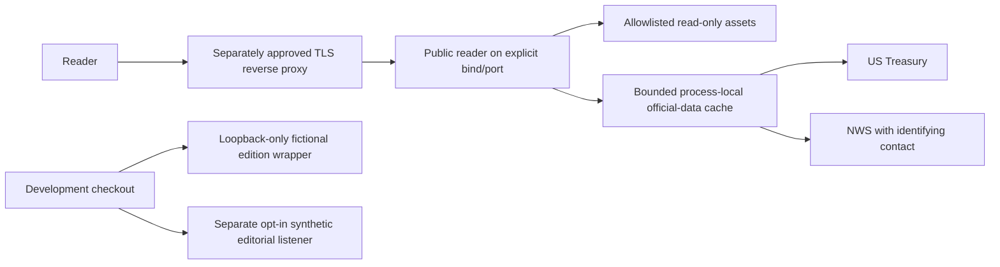

# Public-reader staging and recovery runbook

DL-006A prepares a hosting-neutral read-only public reader. This is a procedure for a future controlled staging release, not authorization to transfer an artifact, publish an image, configure hosting/DNS/firewalls or deploy. No hosting provider is selected. The current authorized work ends with local implementation, validation and a local commit.

## Runtime and trust boundary



The artifact entry point is `src/public/main.ts`. The development `server.ts` wrapper, fictional edition presentation and DL-005B listener are excluded. The public process has no newsroom database, credentials/session repository, editorial mutation service, scheduler, live ingestion, model/audio client or payment client. The only product content is the existing reader interface with clearly labeled fictional demonstration stories and unavailable market/audio placeholders, plus read-only official Treasury/NWS responses.

The deployment must use the inspected artifact, not the full repository checkout. Run it under a dedicated unprivileged operating-system account, with artifact files mounted or permissioned read-only. Grant only outbound official API access and the required listener access; no application database or writable data directory is needed. No package script provisions an operating-system account, production access policy, firewall rule or supervisor. The local smoke tool temporarily changes only its generated artifact files/directories to read-only modes for validation and restores their modes afterward; that does not provision a hosting account or Windows ACL policy. The hosting owner must enforce OS/container UID, filesystem, memory/CPU and network policy. A directory artifact is the supported release format in this milestone; no OCI build, image publication or container validation is claimed.

## Artifact inventory and provenance

`npm run build:public` produces a new `dist/public-reader` directory. The builder refuses to overwrite an existing output directory; preserve an existing inspected build and use a distinct output path for another candidate. The package contains only:

- `src/public/main.ts`, `config.ts`, `reader.ts` and lifecycle support.
- `src/cache.ts` and `src/official-data.ts`.
- `public/index.html`, `style.css`, `app.js` and `stories.js`.
- A generated minimal `package.json` with Node.js 22.16.0/runtime entry metadata.
- `public-manifest.json` with sorted file hashes/sizes, content digest and source commit/tree/dirty provenance.

There are no runtime npm dependencies. `.git`, environment files, credentials, local databases, test artifacts, development dependencies, internal domains, fixture code and development edition assets are absent. Inspection verifies the exact inventory, hashes and import closure; it is not a cryptographic signature, trusted build-service attestation or substitute for reviewing the source commit.

A development build may truthfully record `sourceDirty: true` while implementation is uncommitted. Do not release such a build. After the reviewed local commit is created, build again into a new directory, verify `sourceDirty: false`, confirm the manifest commit equals the reviewed release SHA, and inspect every file. File hashes identify the actual package bytes even when comparing development builds. Build twice from the same unchanged source state to verify deterministic output; changing the commit or dirty state intentionally changes provenance metadata.

## Configuration matrix

Configuration is read from the process environment; `.env.example` is documentation and is not loaded automatically. Unknown `NODE_ENV`, malformed numeric values and incompatible options fail startup with a safe fixed error category rather than falling back to development.

| Variable | Development default | Staging/production policy |
| --- | --- | --- |
| `NODE_ENV` | `development` when absent | Set exactly `staging` or `production`; no silent fallback. |
| `HOST` | `127.0.0.1` | Loopback remains default; `127.0.0.1`, `::1`, or explicitly selected `0.0.0.0`. Wildcard binding is unavailable in development. |
| `PORT` | `3000` | Strict decimal integer 1–65535; may come from the platform. |
| `NWS_USER_AGENT` | Optional; if supplied must be valid | Required identifying application/contact string, at most 256 characters. Enter the real contact privately in process/platform settings. |
| `PUBLIC_BASE_URL` | Optional origin; HTTP or HTTPS | Optional HTTPS origin only; no credentials, path, query or fragment. It does not authorize a proxy or alter request identity. |
| `UPSTREAM_TIMEOUT_MS` | `8000` | 100–10000 per attempt, including response JSON; at most three upstream attempts. |
| `REQUEST_TIMEOUT_MS` | `15000` | 1000–60000; both the Node incoming-request timer and the explicit HTTP response deadline. |
| `HEADERS_TIMEOUT_MS` | `10000` | Incoming-header timer, 1000–30000, no greater than request timeout. |
| `SHUTDOWN_TIMEOUT_MS` | `5000` | 100–30000 graceful-close deadline. |
| `MAX_CONNECTIONS` | `128` | 1–1024 open connections. |
| `MAX_CONCURRENT_REQUESTS` | `32` | 1–128 admitted requests, no greater than max connections. |

Staging/production reject nonempty `DAYLINE_DEV`, `DAYLINE_INTERNAL`, `DAYLINE_EDITORIAL`, `DAYLINE_SYNTHETIC`, `DAYLINE_TEST` and `DAYLINE_AUTH` settings, including their underscore-prefixed option families, plus `SYNTHETIC_PROVIDER`, `TEST_BEARER_TOKEN` and `IDENTITY_PROVIDER`. Do not copy an editorial test environment into this process. The deployed public package has no provider adapter or bearer/session configuration to enable. No production secret, private contact or token belongs in Git, manifest contents, browser assets, shell output or startup logs.

The default `HOST=127.0.0.1` avoids automatic developer-machine exposure. For an approved service behind a same-host proxy, keep loopback and proxy only the selected port. If a reviewed platform/container requires listening on all interfaces, explicitly select staging/production plus `HOST=0.0.0.0` and restrict access using that platform's policy. This document does not authorize doing so on Windows or opening any firewall port. TLS termination, certificate renewal, domain ownership and proxy timeouts require a separately reviewed host configuration. The application does not trust `Forwarded`/`X-Forwarded-*` headers for identity, privileged routing or scheme decisions.

## Health, readiness and official data

| Request | Meaning |
| --- | --- |
| `GET /api/health` | The HTTP process is alive; independent of upstream success. |
| `GET /api/ready` | Assets are readable and the process has observed fresh successful required official data. It performs no upstream probes. |
| `GET /api/debt` | Cached/read-only official Treasury report or explicit unavailable state. |
| `GET /api/weather?city=Tulsa` | Cached/read-only forecast for an allowlisted city or explicit unavailable state. |

Readiness starts at 503 after each restart. It needs readable reader assets, successful Treasury data within the one-hour freshness window, and at least one observed NWS city within its 30-minute window. Every city that has been observed must still have fresh successful data; an observed failure/stale city makes readiness 503 even if another city is fresh. Unrequested cities are unknown, not falsely reported live. Readiness uses observations from ordinary API requests and does not prove current network connectivity or run an automatic polling loop. Health can remain 200 while readiness is 503. A load balancer that sends traffic only after readiness must not leave a cold process permanently unobserved: after separately authorized staging startup, the operator makes one finite `/api/debt` read and one supported `/api/weather?city=Tulsa` read with compliant NWS identification configured, records their actual HTTP/source timestamps as live evidence, then evaluates readiness. This is manual priming, not a repeating probe or fabricated test data. Use `/api/health` for liveness/restart supervision so initial or upstream-related readiness failure does not cause a restart loop. Health bypasses expensive-request admission, while readiness can return 503 at that admission limit; both still depend on available connection capacity.

A failed refresh may serve the last valid record up to the existing 24-hour stale limit with `stale: true`, preserving source date/update time, retrieval/cache timestamps and attribution. That degraded response is useful to the reader but does not establish readiness. Once no permitted cached record remains, the API returns unavailable; no debt, weather or market value is fabricated. Each official request has bounded attempts/timeouts and safe errors. The explicit HTTP response deadline is `REQUEST_TIMEOUT_MS` (15 seconds by default): on expiry the response is 503 and the relevant observed source becomes unavailable. Underlying bounded upstream work may still settle afterward; its admission slot remains held until it settles, and a late outcome does not mark readiness fresh until a later successful public read. The underlying default retry budget is approximately 24.3 seconds for Treasury and 48.6 seconds for sequential NWS point/forecast reads; configured 10-second attempts allow approximately 60.6 seconds for the latter. Review proxy response timeouts against the HTTP deadline plus a small allowance, and resource/admission limits against the longer bounded upstream work. A restart clears all local caches/observations, which may temporarily reduce upstream sharing and readiness; multiple instances do not share cache or upstream quota state.

The process emits structured whitelisted startup/failure/stop metadata and generates request correlation IDs. It does not log NWS contact strings, bearer credentials, arbitrary request targets/headers or raw provider exceptions. Preserve sanitized local logs according to the future operator's reviewed retention policy. No remote telemetry or monitoring vendor is enabled.

## Local build and verification

Use exact Node.js 22.16.0 and the existing lockfile. Repository development tools are installed only for build/test; the generated runtime package needs no `npm install`. Packaged startup validates the manifest and refuses a runtime other than exact Node.js 22.16.0 with a fixed safe error. Unpackaged development compatibility is not a release-runtime guarantee.

```bash
npm ci
npm run check
npm run typecheck
python -m unittest discover -s tests/browser -v
npm run build:public
npm run inspect:public
npm run smoke:public
git diff --check
```

Use a clean new output location if `dist/public-reader` already exists; never overwrite a protected worktree or previous release. For example, with a previously unused candidate name:

```bash
npm run build:public -- --output dist/public-reader-next
npm run inspect:public -- dist/public-reader-next
npm run smoke:public -- dist/public-reader-next
```

The default inspect/smoke commands target the default artifact; pass the candidate path as shown when validating another candidate rather than substituting files into an earlier build. The browser suite requires the documented local Playwright/Chromium/axe prerequisites. CI verifies builds/tests and never deploys from `main`. The [DL-006A validation report](DL-006A_VALIDATION.md) records commands actually executed, artifact results, runtime versions and any tooling limitations; a runbook command alone is not evidence that a check passed.

From the inspected artifact directory, the explicit startup command is:

```bash
node --experimental-strip-types src/public/main.ts
```

Set staging/production variables privately before that command. A local development smoke can omit NWS identification and confirm unavailable weather/readiness behavior; it must not present missing-source readiness as success. For compliant live checks, provide the owner's actual identifying contact without printing it, request only one debt response and a single supported weather city, and record source timestamps/HTTP status separately from deterministic fixture results. Do not activate live news ingestion or use paid providers.

## Windows local acceptance

DL-006A-W1 addresses acceptance tooling rather than production runtime behavior. On PowerShell 5.1 with system Node 24.22.3, the owner observed privilege-related `EPERM` creating links in four security tests, timeouts in two child-process signal tests, and generic smoke startup failure. The smoke process inherited Node 24 while the artifact intentionally requires exact Node 22.16.0. Windows process termination is not equivalent to POSIX signal delivery; neither test tooling nor documentation treats a forced Windows process kill as graceful POSIX shutdown. The old waiter also subscribed to exit after requesting termination and checked only `exitCode`, so it could miss an already signalled exit. W1 registers exit observation at spawn and accounts for both exit and signal state without relabeling a forced kill as a graceful close.

The owner separately reported that original commit `d49ba4065e75ba0893be25b26b722f2581607c97` built and inspected successfully on Windows with clean provenance, eleven runtime/package entries plus the manifest, and no runtime npm dependencies. Manually launching its packaged reader with Node 22.16.0 produced `public_started` in staging and rendered the homepage. The owner confirmed eight manual browser checks, including zoom, navigation, route isolation and Treasury/NWS inspection, and reported two passing GitHub Actions workflows for that original commit. These are owner-reported historical results, not tests performed by the Linux remediation environment. Repeat the W1 acceptance procedure on the new reviewed remediation commit after it is available through a separately authorized handoff.

### Select the side-by-side runtime in PowerShell 5.1

Open PowerShell in the correct, clean reviewed checkout. Do not replace or uninstall system Node. The example resolves the side-by-side installation under the current user's profile rather than embedding an owner's username:

```powershell
$node22 = Join-Path $env:USERPROFILE 'Tools\node-v22.16.0-win-x64\node.exe'
if (-not (Test-Path -LiteralPath $node22 -PathType Leaf)) {
    throw 'Select the existing trusted Node.js 22.16.0 executable.'
}
$node22 = (Resolve-Path -LiteralPath $node22).Path
$nodeVersion = & $node22 --version
if ($LASTEXITCODE -ne 0 -or $nodeVersion -ne 'v22.16.0') {
    throw 'Node.js 22.16.0 is required for artifact acceptance.'
}
$nodeDirectory = Split-Path -Parent $node22
$npmCli = Join-Path $nodeDirectory 'node_modules\npm\bin\npm-cli.js'
if (-not (Test-Path -LiteralPath $npmCli -PathType Leaf)) {
    throw 'The selected Node installation must include its trusted npm CLI.'
}
```

Use the selected executable to invoke npm and temporarily prepend its directory to this shell's PATH. The prepend makes bare `node` invocations inside npm scripts and their children resolve consistently. Restore the prior PATH in `finally`; no machine/user PATH setting or existing Node installation is modified. PowerShell 5.1 does not support the shell `&&` form, so each external exit code is checked explicitly:

```powershell
$previousPath = $env:PATH
try {
    $env:PATH = $nodeDirectory + [IO.Path]::PathSeparator + $previousPath
    $scriptNodeVersion = & node --version
    if ($LASTEXITCODE -ne 0 -or $scriptNodeVersion -ne 'v22.16.0') {
        throw 'npm script Node selection is inconsistent.'
    }
    & $node22 $npmCli ci
    if ($LASTEXITCODE -ne 0) { throw 'Locked dependency installation failed.' }
    & $node22 $npmCli run check
    if ($LASTEXITCODE -ne 0) { throw 'Static/backend/security checks failed.' }
    & $node22 $npmCli run typecheck
    if ($LASTEXITCODE -ne 0) { throw 'TypeScript check failed.' }

    # Use fresh paths. The builder never overwrites a previous artifact.
    $candidateBase = Join-Path 'dist' ('public-reader-w1-' + (Get-Date -Format 'yyyyMMdd-HHmmss'))
    $candidateA = $candidateBase + '-a'
    $candidateB = $candidateBase + '-b'
    & $node22 --experimental-strip-types scripts/build-public.ts --output $candidateA
    if ($LASTEXITCODE -ne 0) { throw 'First public artifact build failed.' }
    & $node22 --experimental-strip-types scripts/build-public.ts --output $candidateB
    if ($LASTEXITCODE -ne 0) { throw 'Second public artifact build failed.' }
    & $node22 --experimental-strip-types scripts/inspect-public.ts $candidateA
    if ($LASTEXITCODE -ne 0) { throw 'First artifact inspection failed.' }
    & $node22 --experimental-strip-types scripts/inspect-public.ts $candidateB
    if ($LASTEXITCODE -ne 0) { throw 'Second artifact inspection failed.' }
    & $node22 --experimental-strip-types scripts/smoke-public.ts $candidateA --node $node22
    if ($LASTEXITCODE -ne 0) { throw 'Artifact smoke failed.' }
} finally {
    $env:PATH = $previousPath
}
```

The default smoke command uses the parent process's executable, but validates its version before launching the reader. The explicit `--node` override is an absolute path to a trusted installed Node executable and is checked before use. An invalid selection, failed probe or unsupported version produces a fixed sanitized `SMOKE_RUNTIME_INVALID`, `SMOKE_RUNTIME_PROBE_FAILED` or `SMOKE_UNSUPPORTED_RUNTIME` category. It never silently chooses another runtime. Startup/shutdown or isolation failures remain failures rather than being relabeled as platform skips. The production artifact independently retains its own exact runtime pin and Node 24 rejection; the override changes only which executable the local smoke tool launches.

For a build made from the reviewed clean commit, inspect each manifest without dumping environment/contact settings:

```powershell
$manifestA = Get-Content -LiteralPath (Join-Path $candidateA 'public-manifest.json') -Raw | ConvertFrom-Json
$manifestB = Get-Content -LiteralPath (Join-Path $candidateB 'public-manifest.json') -Raw | ConvertFrom-Json
$reviewedHead = git rev-parse HEAD
if ($LASTEXITCODE -ne 0) { throw 'Cannot read reviewed local HEAD.' }
if ($manifestA.provenance.sourceDirty -or $manifestB.provenance.sourceDirty) {
    throw 'Dirty builds are not release candidates.'
}
if ($manifestA.provenance.commit -ne $reviewedHead -or $manifestB.provenance.commit -ne $reviewedHead) {
    throw 'Artifact provenance does not match reviewed local HEAD.'
}
if ($manifestA.contentDigest -ne $manifestB.contentDigest) {
    throw 'Repeated runtime content digests differ.'
}
$manifestHashA = (Get-FileHash -LiteralPath (Join-Path $candidateA 'public-manifest.json') -Algorithm SHA256).Hash
$manifestHashB = (Get-FileHash -LiteralPath (Join-Path $candidateB 'public-manifest.json') -Algorithm SHA256).Hash
if ($manifestHashA -ne $manifestHashB) { throw 'Repeated manifests differ.' }
```

Inspection verifies the named runtime bytes against each manifest; equal hashes/digests are evidence of repeated-build identity, not proof of a trusted source or signed provenance. Both artifacts must still contain exactly twelve physical files and no test harness, private domains, credentials or runtime npm dependencies.

### Interpret capability and lifecycle results

The suite probes file and directory symlink creation in harmless, isolated temporary fixtures and verifies that the created link is actually a link. Supported capabilities run the original rejection assertions. Only `EPERM` or `EACCES` from the actual link-creation operation on Windows is treated as a privilege-related unavailable capability. Setup, inspection, cleanup and other errors still fail, as do equivalent errors on POSIX. Each probe disposes only its own isolated temporary fixture in `finally`. Independent output-preservation, duplicate-key manifest and missing-asset checks run in separate cases even if links cannot be created. There are four link-dependent checks: three require file links and one requires a directory link. Record TAP's pass/fail/skip totals and each skip reason. A skipped symlink assertion is not a passing security assertion. Linux continues to execute strict link rejection. No test elevates automatically, enables Developer Mode or changes Windows security settings.

The two CLI SIGTERM/SIGINT tests remain strict on POSIX. On Windows those POSIX-specific cases are explicitly identified as unavailable; a test-only controlled IPC child verifies the same public runtime's close path instead. It stops HTTP admission, checks bounded accepted work/socket cleanup and verifies that no new request succeeds after shutdown starts. The child-exit observer is registered before termination, accounts for exit and signal state, and cleans up failed/orphaned children. The IPC worker lives under `tests/helpers` and is excluded from the artifact; it creates no shutdown HTTP endpoint or deployed administration seam. The Windows path does not claim SIGTERM/SIGINT parity. If both Windows link capabilities are unavailable, four link checks plus the two POSIX-only signal cases are expected to be explicitly skipped; this is conditional accounting, not a claimed Windows run. Supported capabilities reduce that skip count. The independent security checks and the controlled IPC lifecycle check still run. Record actual Windows controlled-close results separately from Linux POSIX results and from deterministic simulated Windows helper cases.

### Manual reader acceptance

Use the documented Python/Playwright/Chromium setup. For browser regression, temporarily select Node in the same way as above:

```powershell
$previousPath = $env:PATH
try {
    $env:PATH = $nodeDirectory + [IO.Path]::PathSeparator + $previousPath
    python -m unittest discover -s tests/browser -v
    if ($LASTEXITCODE -ne 0) { throw 'Chromium regression failed.' }
} finally {
    $env:PATH = $previousPath
}
```

Start the inspected artifact from the same validated PowerShell session, where `$node22` and `$candidateA` remain defined, using the explicit executable. In a new terminal, reestablish those variables to the selected executable and the already inspected candidate; terminal variables are not shared:

```powershell
$env:NODE_ENV = 'staging'
$env:HOST = '127.0.0.1'
$env:PORT = '3000'
# Set NWS_USER_AGENT privately to the owner's real identifying contact first.
# Do not echo it, put it in a URL, or commit an environment file.
& $node22 --experimental-strip-types (Join-Path $candidateA 'src\public\main.ts')
```

Check homepage, safe assets and official panels; distinguish `/api/health` from `/api/ready`. Record source timestamps only for actual compliant live requests. Confirm GET/HEAD support, 404 for `/internal/principal`, `/auth`, `/api/admin`, `/src/security/http.ts` and `/dev/edition`, and 405 for an editorial-looking POST. Use the terminal's normal Ctrl+C interaction, record the observed stop/restart behavior, and confirm that restarted readiness is initially unknown. This manual console observation is separate from programmatic Windows child termination. Do not open firewall ports or activate the private editorial listener.

The source checkout's opt-in fictional edition remains development-only and is absent from the artifact. Repeat and record the relevant W1 Windows physical/browser checks, including native zoom and navigation; keyboard/assistive-technology coverage not already demonstrated remains separate. Automated Chromium/axe and simulated Windows tests do not certify WCAG conformance or prove an actual Windows rerun. Foundation 001 acceptance and the owner's original DL-006A results remain historical acceptance.

## Prepared staging release gate — manual authorization required

Complete and review all items before any external operation:

- Identify the reviewed clean source commit and a verified deterministic artifact; retain manifest/content hashes outside the mutable runtime.
- Review the explicit artifact inventory/import boundary and ensure no environment file, credential, local repository, fixture or internal service is present.
- Pass the automated suites, artifact startup/shutdown/isolation checks and required physical/live acceptance; record any remaining blocker.
- Select and review hosting, exact Node runtime provisioning, non-root account, read-only files, resource limits, TLS/reverse-proxy rules, outbound official API access and private NWS contact injection.
- Review display/attribution/demonstration policy, source API terms, privacy/security/accessibility and relevant retention controls.
- Prepare the prior known-good version, operator ownership, rollback decision thresholds, log access and incident/restart procedure.
- Obtain explicit owner authorization for the exact external transfer/deployment and any DNS/firewall changes. No current task, Git commit, passing CI or merge implies this approval.

Only after that authorization, place the inspected candidate in a new immutable release/version directory using the selected platform's approved process. Verify hashes after transfer, start it under the unprivileged account on an explicitly restricted port, and smoke-test directly before proxy promotion. Confirm reader/static/API method rules, internal/development route absence, health/readiness semantics, graceful termination and compliant official-source behavior. Do not send real production credentials to any synthetic/editorial route. Promote through an atomic platform release switch only after the candidate's acceptance evidence is reviewed; retain the previous version and its configuration mapping.

## Restart, rollback and previous-version recovery

Use the future selected supervisor's bounded restart policy with backoff and an attempt ceiling; do not loop endlessly on invalid configuration or an upstream outage. Treat configuration failure as a release blocker. On POSIX, SIGTERM/SIGINT stops acceptance, drains admitted requests up to the configured deadline, then closes remaining sockets. Windows console/service-manager termination must be accepted for the selected host separately; the local controlled IPC harness verifies the close path without claiming identical signal delivery. Match the supervisor grace period to that deadline with a small allowance. Upstream-only failures should be diagnosed through readiness/source status rather than falsely marked healthy data or automatically triggering an uncontrolled restart storm.

Rollback triggers include wrong artifact/hash, unexpected public route or secret exposure, invalid configuration, startup/shutdown failure, reader regression or unaccepted source/readiness behavior. Stop admission to the candidate through the selected platform's controlled release switch. Restore the previous inspected version directory and its reviewed configuration atomically, start/check it under the same least-privilege policy, then verify health, source observations and route isolation before returning traffic. Restarting either version clears cache; a temporary 503 readiness state is expected until valid samples are observed. This reader stores no newsroom or payment data, so no application database rollback is part of this procedure.

If the previous runtime files are lost, obtain the previously reviewed commit in a separately authorized clean checkout/worktree, verify identity/commit and rebuild/inspect into a new output directory, comparing retained manifest/content hashes before promotion. Preserve failed candidate files and sanitized evidence; do not reset, stash, clean or overwrite a checkout with protected work. If an artifact/configuration mismatch cannot be explained, stop and seek review rather than silently substituting a new build. No recovery command in this document is executed by this milestone.

## Outstanding launch blockers

No external deployment, image registry upload, production DNS/firewall configuration, real identity provider, paid observability, live news ingestion, production scheduler, model/audio generation, publication or payment activation has been performed. A reviewed staging host/proxy/UID/resource policy, current source API compatibility/identification, accepted physical/accessibility checks, operational ownership and explicit release authorization remain necessary. Production editorial identity/authorization, licensing, durable storage and publication controls remain separately blocked; publishing the reader artifact would not complete them.
