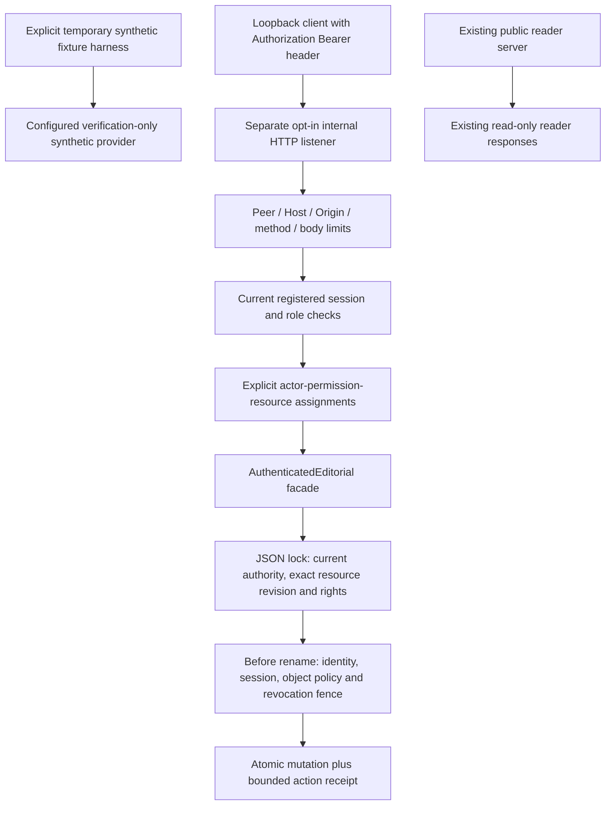

# DL-005B local validation

Executed 2026-11-12 (America/Chicago). This milestone adds a synthetic development HTTP boundary; it is not production identity integration or security certification.

## Recovery and preflight

The earlier attempt stopped before preflight with no implementation. On recovery, shell execution and attachment download both succeeded and the complete original assignment was read. GitHub repository identity is `https://github.com/MauroDot/Dayline.git`. Ordinary Git reads verified remote main at `9c44f2ff9a19b5d42cb5ee032dbacbde01c68293`, and a non-force fetch obtained that exact baseline. The proposed local branch, remote branch and worktree directory were absent.

Created `/workspace/Dayline-dl005b`, branch `feature/dl-005b-authenticated-entrypoints`, at that exact starting commit and verified a clean index/tree. All thirteen existing worktrees were inventoried first. The original `/workspace/Dayline` retains its fifteen staged files; the twelve other prior worktrees were clean at their previously recorded commits. Branches, HEADs, porcelain status, staged/unstaged binary diffs, tracked file inventories and content hashes were recorded in `/tmp/dayline-005b-protected-baseline.json` for final comparison. No existing worktree was reset, stashed or overwritten.

The final feature commit is recorded by `git log -1` and the completion handoff; this report is included in that commit. No push, PR, merge or deployment is authorized.

## HTTP trust boundary



The dedicated listener is disabled by default and requires explicit `enabled: true` and development mode; production mode rejects startup. It binds only `127.0.0.1`. Strict peer, literal Host/port, Origin, duplicate-header and forwarding-header checks restrict requests. It grants no CORS permission, accepts no cookie authentication, rejects query strings, and exposes no credential-minting, identity-administration or publication endpoint. The public reader server and browser assets are unchanged.

Credentials travel in the Authorization header over the local loopback test connection. This is not TLS transport or browser cookie security. CSRF cookie protections are inapplicable because cookies are rejected; hostile Origin, preflight and cross-site request metadata are rejected independently. Responses use `no-store`, fixed error codes and newly generated correlation IDs. Tokens, keys, provider subjects and raw provider/storage exceptions are not reflected or logged.

`configureIdentityVerifier` accepts explicit trusted synthetic configuration, returning a provider-independent verification-only interface. It pins the concrete verifier implementation and rejects injected/subclass verifiers, unknown providers and production configuration. Integrity, algorithm, issuer, audience, key identity, times and registered-session metadata must agree. Arbitrary key URLs never trigger network access. The production-provider seam always denies. The fixture creates only a fresh temporary repository and invented identities, with a fresh random signing key held in memory.

## Endpoint and permission matrix

All paths below are on the separate internal listener. All require a current registered credential.

| Method and path | Additional permission and resource requirement |
| --- | --- |
| GET `/internal/principal` | Current identity; returns only safe identity/role/permission fields. |
| POST `/internal/session/revoke` | Own session only; exact empty JSON object. |
| POST `/internal/stories` | `STORY_CREATE`, explicit proposed story ID. |
| POST `/internal/stories/:id/edit` | `STORY_EDIT`, assigned story and exact current version. |
| POST `/internal/stories/:id/review` | `STORY_REVIEW`, assigned story/version; nonfinal transitions only. |
| POST `/internal/stories/:id/approve` | `STORY_APPROVE`, assigned story/version and existing eligibility checks. |
| POST `/internal/editions` | `EDITION_ASSEMBLE`, assigned canonical date/timezone slot and each exact placement story. |
| POST `/internal/editions/:id/review` | `EDITION_REVIEW` or `EDITION_READY`, assigned edition and contained stories; exact revision. |
| GET `/internal/schedules` | `SCHEDULE_CONFIGURE`/`SCHEDULE_EXECUTE`; only assigned safe schedule/run DTOs. |
| POST `/internal/schedules/:id/pause` | `SCHEDULE_CONFIGURE`, assigned schedule and exact state fingerprint. |
| POST `/internal/runs/:id/claim` | `SCHEDULE_EXECUTE`, assigned run and exact state fingerprint. |

Role membership never substitutes for an object assignment. Creation allocates only an explicitly assigned ID/edition slot; it confers no implicit ownership or subsequent review permission. Assignments are bounded, copied trusted configuration, not request fields or a new persistent ownership schema. Unsupported scoped bulk scheduler operations deny access. Policy callbacks receive defensive copies and must synchronously return undefined or throw; promises and returned decisions fail closed. Existing source eligibility, retention holds, revision checks and administrator/editor separation remain enforced.

HTTP mutations use the authenticated facade. They additionally restrict referenced content to the explicitly fictional source formats; actual provider data cannot be promoted through this development interface. Story/draft/edition legacy reviewer assertions remain unauthenticated. Receipts separately bind the verified actor to the resulting resource revision.

## Revocation and atomicity

The internal listener keeps a bounded session-ID revocation fence. Once an own-session revocation request has authenticated and passed body validation, it fences that session before awaiting the repository lock. Its other in-flight HTTP mutations check this fence again immediately before commit. A failed durable revocation write leaves the local fence in place; restart loses the process-only fence, so durable revocation success is a separate condition. Entries are removed only after expiry. This is local listener coordination, not a distributed identity-provider guarantee.

Completed identity/session changes before a request acquires the repository lock are seen by that request. Current credential, roles, identity revision, bound actor/session and object policy are rechecked before atomic rename. Expiry, effective revocation or object denial rolls back editorial mutation and success receipts together. Initial authorization/object denials precede lifecycle scrubbing. Known safe retention scrubs after successful authorization may persist on domain rejection, as in DL-005A.

Direct trusted administration still serializes through the JSON lock: a later queued external revocation cannot retroactively undo an earlier committed transaction. Failed security logging may be lost during storage failure. The JSON repository and process-only policies are not production transactional infrastructure or tamper-proof audit storage.

## Legacy bypass inventory

The complete method-level inventory and classification is in [SECURITY_DESIGN.md](SECURITY_DESIGN.md). Public `server.ts` exposes no caller-selected mutation endpoint. Its development edition preview owns a disposable fictional repository and may seed/revalidate that scratch fixture; it cannot select the internal listener's repository.

Direct `Newsroom`, `EditorialService`, `EditionService`, scheduler services, identity administration, lifecycle/retention helpers and raw `JsonRepository` transactions remain trusted internal development composition. They are unsafe as unmediated production entry points. The new listener invokes no legacy mutation service directly. Production-provider activation and public publishing remain disabled.

## Executed validation

| Check | Executed result |
| --- | --- |
| Runtime | Node.js **22.16.0**, npm **11.9.0**, TypeScript **5.9.3**. |
| Locked installation | `npm ci` passed: three existing development packages; no dependency/lockfile changes. |
| Full CI-equivalent check | `npm run check` passed, including TypeScript, public script syntax and **530/530 backend/domain/security tests**, zero failures/skips/cancellations (10.149 seconds). |
| Targeted security/HTTP | **71/71 passed**, zero failures/skips/cancellations (4.057 seconds). These are included in the 530, not additional to it. |
| Chromium regression | **18/18 passed** (20.782 seconds) on the unchanged reader implementation. |
| Targeted axe | Zero violations in the existing tested loaded/empty/unavailable reader states; no formal WCAG certification. |
| Startup/shutdown/isolation | Default listener disabled; explicit loopback principal 200; public homepage/health 200; public internal GET 404 and mutation POST 405; security source file 404; listener shutdown and scratch-fixture cleanup passed. |
| Whitespace/scope | `git diff --check` passed. Sixteen approved files; no public server/assets, dependency or GitHub workflow changes. |
| Protected worktrees | All thirteen match recorded branches, HEADs, index/worktree diffs and tracked file hashes; original fifteen staged files preserved. |

The original 459-test baseline remains passing. Added tests comprise **11 provider/harness**, **16 resource-policy**, **18 HTTP transport** and **26 HTTP integration** cases. They cover default/production disablement; loopback/Host/Origin/CORS/forwarding rejection; unsigned/tampered/unknown/expired/revoked credentials; wrong issuer/audience/key/algorithm; object, role, revision and placement restrictions; repository/access configuration mismatch; administrator separation; callback return/async rejection; in-flight durable and local-fenced revocation; exact commit-time expiry/revocation rollback; storage failures without false receipts; safe errors and no credential-minting/publication/legacy HTTP bypass.

Transport limits are 16,384 body bytes with a one-second receive deadline, 12,288 header bytes, 48 raw headers, five-second header/request timers checked at one-second intervals, 32 concurrent connections and one request per connection. Native parser rejection of excessive headers may return 400 before the application can return 431; both are tested as rejection. Shutdown stops admission, fences pending mutations and awaits handler completion before fixture disposal.

The default fixture clock advances from its fictional epoch using monotonic elapsed time; explicit test clocks remain available. Review also added strict synchronous object-policy decisions and startup repository/access binding. A final full run passed after these refinements. Node's experimental type-stripping warning is expected on 22.16.0. An initial sandboxed package command could not reach the managed proxy; the same locked installation succeeded through the approved outer execution path with policy and CA trust retained. No network restriction was bypassed.

Exact runtime commands included:

```bash
npx --yes --package=node@22.16.0 -c 'node --version && npm --version && npm ci'
npx --yes --package=node@22.16.0 -c 'node --version && npm run check'
npx --yes --package=node@22.16.0 -c 'PYTHONDONTWRITEBYTECODE=1 python -m unittest discover -s tests/browser -v'
```

Session evidence is in `/tmp/dayline-005b-install.log`, `/tmp/dayline-005b-final-check.log`, `/tmp/dayline-005b-targeted.log`, `/tmp/dayline-005b-browser.log` and `/tmp/dayline-005b-smoke.log`. Temporary logs may not survive environment replacement; this report preserves their actual outcomes. No live Treasury/NWS or news-provider request was made, and no GitHub CI run or remote write was performed.

## Complete changed-file inventory

| File | Change |
| --- | --- |
| `README.md` | Development HTTP overview and validation links. |
| `docs/AI_EDITORIAL_DESIGN.md` | Authenticated scope and legacy fixture separation. |
| `docs/ARCHITECTURE.md` | Isolated listener and object boundary. |
| `docs/DL-005B_VALIDATION.md` | Preflight, executed evidence, inventory and limitations. |
| `docs/EDITION_DESIGN.md` | Scoped edition/scheduler operations and revisions. |
| `docs/ROADMAP.md` | DL-005B implementation and acceptance status. |
| `docs/SECURITY_DESIGN.md` | Trust/endpoint matrix, bypass inventory and Windows instructions. |
| `fixtures/editorial-http-fiction.ts` | Explicit temporary harness, advancing fictional clock and in-memory synthetic credentials. |
| `src/security/editorial.ts` | Transaction-bound resource checks and scoped schedule/run operations. |
| `src/security/http.ts` | Dedicated constrained listener, safe transport and revocation fence. |
| `src/security/provider.ts` | Trusted synthetic verifier composition and disabled production seam. |
| `src/security/resources.ts` | Immutable explicit assignments and exact procedural fingerprints. |
| `tests/security-http-integration.test.ts` | End-to-end domain authorization, races, storage rollback and public isolation. |
| `tests/security-http.test.ts` | Transport, startup/configuration, body limits and safe errors. |
| `tests/security-provider.test.ts` | Provider configuration, key/claim denial and temporary harness lifecycle. |
| `tests/security-resources.test.ts` | Resource binding, assignment denial and precommit checks. |

## Reproduction and physical acceptance

Use Node.js 22.16.0 and the existing lockfile:

```bash
npm ci
npm run check
npm run typecheck
node --experimental-strip-types --test tests/security-provider.test.ts tests/security-resources.test.ts tests/security-http.test.ts tests/security-http-integration.test.ts
PYTHONDONTWRITEBYTECODE=1 python -m unittest discover -s tests/browser -v
git diff --check
```

The browser suite requires the existing Python Playwright/Chromium and local axe bundle described in README. Windows instructions, explicit harness composition and credential-handling limits are in [SECURITY_DESIGN.md](SECURITY_DESIGN.md). On Windows, use `npm.cmd`, run local suites, check existing reader layout and official data separately, and exercise only loopback requests. Do not open firewall ports or expose the listener. Native 200%/400% browser zoom, assistive technology and Windows physical acceptance remain separate manual work; automated Chromium results do not establish that acceptance.

## Remaining production blockers

Real provider verification/revocation, secure identity bootstrap and key management, durable transactional storage, exclusive authenticated entry points, production object/tenant assignments, independent security review, monitoring, trusted time and incident/recovery/audit controls remain necessary. Local header transport has no TLS claim, synthetic credentials do not establish real identity, and raw trusted service/filesystem access can bypass the facade. Licensing, cross-system retention/deletion and publication/deployment authorization remain separate requirements. No real provider/account, live ingestion, production scheduler, public publishing, paid AI, voice or Stripe service was activated.
