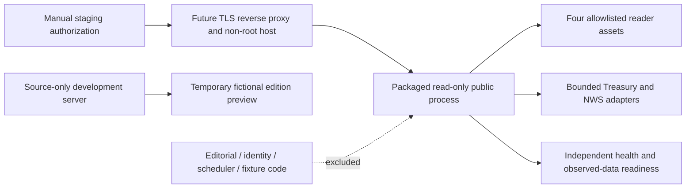

# DL-006A local validation

Executed 2026-11-13 (America/Chicago). Authorization covers isolated implementation, local tests, documentation and a local commit only. No external release, image publication or public deployment was performed.

## Baseline and preservation

Repository origin was verified as `https://github.com/MauroDot/Dayline.git`. A read-only remote query and non-force fetch verified main at **`bcb0687deaadd7ddd406f62fab82279e8593a3a8`**. The feature branch and proposed directory were unused. Created `/workspace/Dayline-dl006a`, branch `feature/dl-006a-public-deployment-foundation`, at that exact commit and confirmed a clean index and tree before implementation.

All fourteen existing worktrees were inventoried and compared with the previous protected-state record. `/workspace/Dayline` retains its fifteen staged files, and the other thirteen prior worktrees were clean at their recorded commits. Branches, HEADs, porcelain status, staged/unstaged binary diffs, tracked inventory and file-content hashes were recorded in `/tmp/dayline-006a-protected-baseline.json` for final comparison. No reset, stash, clean, overwrite or branch deletion was used.

The final feature SHA is provided in the completion handoff and `git log -1`; this report is included in that commit. Generated artifact provenance records the exact build commit/tree and actual runtime file hashes.

## Build and runtime architecture

The supported release format is an allowlisted directory artifact at `dist/public-reader`, not a container image. It requires the externally provisioned, exact **Node.js 22.16.0** runtime and no application dependencies. The packaged process refuses another Node version. The directory was chosen to provide a hosting-neutral executable artifact without adding an image registry, container base-image supply chain or deployment provider.



The source-only `server.ts` retains the synchronous `createServer` API and existing fictional preview for development compatibility. It is excluded from the artifact. The packaged `src/public/main.ts` imports only configuration, lifecycle and the pure reader core. No private editorial listener is mounted or packaged.

The artifact contains twelve files: `public-manifest.json`, generated minimal `package.json`, `src/public/{config,main,lifecycle,reader}.ts`, `src/cache.ts`, `src/official-data.ts`, and `public/{index.html,style.css,app.js,stories.js}`. It excludes `.git`, all environment files, local databases, tests, build scripts, development dependencies, edition assets, synthetic credentials, fixtures, authentication, newsroom and scheduler implementations.

Build and inspection enforce exact inventory, regular files without symlink traversal, canonical metadata, SHA-256 hashes and the complete TypeScript/JavaScript import closure. Runtime builtins are restricted to crypto, filesystem promises, HTTP, net, path and URL. Privileged module/process loaders, dynamic unknown imports, code generation, bare dependencies and credential patterns fail inspection. Existing output paths are rejected rather than overwritten. Two builds from identical inputs must be byte-identical.

Manifest provenance includes the Git commit and tree, dirty-source flag, pinned runtime, each file's size/hash and a content digest. A dirty build is development evidence, not a release candidate. Hashes are not a signature or proof of independent attestation. The runbook requires an inspected clean committed artifact and a separately authorized manual release gate.

## Configuration and HTTP boundaries

Typed configuration distinguishes development, staging and production; unknown/blank modes fail. Default binding is loopback, including on Windows. A platform port is accepted only as a strict integer from 1–65535. All-interface binding requires an explicit nondevelopment setting. Staging/production require identifying NWS configuration and reject development/private/synthetic activation variables. Optional public origin configuration excludes credentials, paths, queries and fragments and requires HTTPS outside development.

Configuration and listener failures produce fixed structured codes without environment values, NWS contact information, authorization headers, raw provider errors, stack traces or local paths. Request IDs are generated rather than accepted from callers. No real provider, credentials, external telemetry, paid service, payments, publishing or scheduling activation was introduced.

The pure reader permits GET/HEAD only. Static files are an exact four-file allowlist with content-type checks and symlink rejection. Security headers apply to normal and error responses; JSON is `no-store` and assets require revalidation. Internal/auth/editorial/scheduler/database/source paths remain unavailable. Staging and production do not invoke a development extension even if supplied programmatically.

There are four fixed weather cache slots plus one Treasury cache, with concurrent-load coalescing and bounded stale handling. Defaults are 128 connections, 32 expensive concurrent handlers, 15-second receive/response deadlines, 10-second header timeout and five-second shutdown grace; all configurable bounds are listed in the deployment runbook. Health bypasses expensive-work admission. Timed-out underlying official loads may finish within their bounded retry budget, retaining their admission slot until completion; a late load cannot erase an observed response timeout until a subsequent successful public request.

## Health, readiness and official data

`GET /api/health` is process liveness and remains 200 during upstream admission saturation. It does not assert official-data availability. `GET /api/ready` verifies application assets and observed fresh Treasury plus at least one sampled NWS location; all sampled locations must be fresh. Initial unknown, stale, expired or failed data returns 503. Readiness never triggers an upstream fetch and is not a real-time government-service probe.

After a separately authorized staging start, an operator must manually prime debt and one valid weather location with compliant real identification before using readiness to admit traffic. Liveness, not upstream readiness, drives process restart. Outages must not cause restart loops. Retry budgets, response deadlines, restart backoff and rollback are documented in [DEPLOYMENT_RUNBOOK.md](DEPLOYMENT_RUNBOOK.md).

Treasury exact-cent reconciliation and official reporting dates are retained. Weather identification is passed explicitly from validated deployment configuration; legacy development calls retain their compatibility path. Official adapters validate responses, use bounded retries/timeouts and preserve unavailable/stale states without fabricated figures or forecasts. This validation uses deterministic synthetic responses only. No live Treasury, NWS or news-provider request was made.

## Executed validation

| Check | Actual result |
| --- | --- |
| Tool versions | Node.js **22.16.0**, npm **11.9.0**, TypeScript **5.9.3**. |
| Locked installation | `npm ci` passed; three existing development packages, no dependency/lockfile changes. |
| Full check | `npm run check` passed: TypeScript, public JavaScript syntax and **602/602 backend/domain/security tests**, zero failures/skips/cancellations; 32.391 seconds. |
| Accepted baseline | Existing **530** tests remain passing; **72** deployment tests added. |
| New test breakdown | 15 artifact, 22 configuration/runtime, 18 reader and 17 official-upstream cases. All included in 602. |
| Chromium | **18/18 passed**, 38.235 seconds; targeted axe loaded/empty/unavailable states had zero violations. |
| Reproducible build | Two actual twelve-file builds byte-identical, including their manifests; 69,046 bytes in the inspected precommit artifact. |
| Artifact inspection | Exact inventory, pinned runtime, hashes, source provenance, excluded files and restricted import closure passed. |
| Runtime smoke | Both staging/SIGTERM and production/SIGINT passed, non-root POSIX user and temporarily read-only artifact, zero upstream requests, unchanged artifact bytes. |
| Wrong runtime | Actual Node **24.22.1** startup rejected with exit 1 and fixed `UNSUPPORTED_PUBLIC_RUNTIME`, without reflecting identification. |
| Whitespace/scope | `git diff --check` passed. Twenty-four approved source/test/config/documentation files; no reader asset or dependency changes. |
| Protected state | All fourteen prior worktrees match branch, HEAD, status, index/worktree diffs, tracked inventory and content hashes; original fifteen staged files preserved. |

The runtime smoke verified homepage and health 200, readiness 503 for unobserved dependencies, internal GET 404, internal mutation POST 405, development preview 404, environment/source paths 404, no credential reflection and clean bounded signal exits. Reader tests separately verified readiness 200 only after deterministic official-adapter successes, failure/staleness/expiry 503, no readiness-generated upstream calls, liveness during capacity saturation, coalesced cache loads and late-result handling. These are deterministic fixture results, not live API evidence.

Additional coverage includes strict startup failures, malformed/missing artifact identity, exact Node pinning, safe logs, platform ports and bindings, disabled private/development activation, static methods/content types/headers, forced socket shutdown, safe existing-output preservation, symlink exclusion, byte/hash/import/package tampering and secret sentinels. Adapter tests cover bounded fetch/body deadlines, three-attempt exhaustion/recovery, 1 MiB response limits with cancellation, strict Treasury dates/decimal bounds, strict NWS text/timestamp schemas and no fabricated values. The existing exact-cent and reporting-date tests passed unchanged.

Final precommit artifact content digest:

```text
f9db920b1da1ef1ae65f1cd68d34eaf47b444729b5c3b04a4e1c6d91c2381b5a
```

The validation build honestly records `sourceDirty: true` against the verified starting commit; it is not represented as a clean release. After the local implementation commit, preserve that build and regenerate the default artifact from the clean committed source, then inspect/smoke it again. The completion handoff records that final commit and artifact provenance. This avoids a self-referential SHA in this committed report.

Node 22's experimental type-stripping warning is expected. Git required the approved outer execution path because the command sandbox could not connect to the managed proxy; TLS trust and destination policy were retained. There were no skipped final tests. An initial complete run passed 600 tests before the two final provenance-fallback regressions; the final run passed 602 after that fix. Docker CLI is present but no Docker/OCI image was built or tested; directory artifact execution is the explicitly supported alternative, and no container validation is claimed.

Logs: `/tmp/dayline-006a-install.log`, `/tmp/dayline-006a-final-validation.log`, `/tmp/dayline-006a-final-browser.log`, `/tmp/dayline-006a-repro.log`, `/tmp/dayline-006a-repro-evidence.json` and `/tmp/dayline-006a-runtime-negative.json`. Temporary session evidence may not survive replacement; this report preserves the actual outcomes. GitHub CI was updated but not run remotely in this local-only task.

## Complete changed-file inventory

| File | Purpose |
| --- | --- |
| `.env.example` | Safe public configuration examples without private contacts. |
| `.github/workflows/ci.yml` | Local artifact build, inspection and smoke gates; no deployment. |
| `README.md` | Public artifact commands, health/readiness and boundaries. |
| `docs/ARCHITECTURE.md` | Pure-reader runtime and release artifact separation. |
| `docs/DEPLOYMENT_RUNBOOK.md` | Configuration, staging authorization, restart, rollback and Windows procedure. |
| `docs/DL-006A_VALIDATION.md` | This executed evidence and limitation report. |
| `docs/ROADMAP.md` | DL-006A implementation, validation and launch blockers. |
| `docs/SECURITY_DESIGN.md` | Public packaging and trust boundary. |
| `package.json` | Build/inspect/start/smoke commands without new dependencies. |
| `scripts/build-public.ts` | Deterministic allowlisted directory builder. |
| `scripts/inspect-public.ts` | Hash, inventory, provenance and AST import inspection. |
| `scripts/smoke-public.ts` | Local non-root/read-only artifact and signal smoke. |
| `server.ts` | Source-only development composition retaining existing preview API. |
| `src/official-data.ts` | Bounded official fetch/body handling and response validation. |
| `src/public/config.ts` | Typed fail-closed process settings. |
| `src/public/lifecycle.ts` | Bounded connection draining and signal handling. |
| `src/public/main.ts` | Independent public entry, safe logs and artifact identity/runtime checks. |
| `src/public/reader.ts` | Restricted reader HTTP, cache/admission limits and readiness. |
| `tests/public-artifact.test.ts` | Determinism, exclusions, tampering and output preservation. |
| `tests/public-config.test.ts` | Environment, port, bind, identification and limit validation. |
| `tests/public-reader.test.ts` | Public headers/routes/readiness/cache and capacity behavior. |
| `tests/public-runtime.test.ts` | Startup, identity/provenance, safe failure and shutdown behavior. |
| `tests/public-upstream.test.ts` | Time/body limits, schemas, safe failures and official timestamps. |
| `tsconfig.json` | Include deployment build/inspection/smoke scripts in static checking. |

## Reproduction

Use Node.js 22.16.0 and the existing lockfile:

```bash
npm ci
npm run check
PYTHONDONTWRITEBYTECODE=1 python -m unittest discover -s tests/browser -v
npm run build:public
npm run inspect:public
npm run smoke:public
git diff --check
```

For another build, use a fresh output (`npm run build:public -- --output dist/public-reader-candidate`), then inspect and smoke that exact path. Builds refuse existing destinations. The smoke script starts staging and production children on loopback, uses only synthetic configuration, makes zero upstream requests and checks health/readiness, route isolation, unchanged artifact bytes and bounded SIGTERM/SIGINT exits. On POSIX it temporarily removes artifact write permissions and restores their original modes afterwards. This affects only the generated, inspected artifact; Windows mode bits are not claimed to enforce the same ACL boundary.

The updated GitHub workflow executes local build, inspection and smoke steps after tests. It has no image upload or deployment step. No GitHub CI run is claimed from this local-only task.

## Launch blockers and acceptance

No external staging service is deployed. Hosting selection, independently provisioned Node runtime, non-root service identity, read-only filesystem policy, TLS termination, outbound access, operational monitoring, edge capacity/rate limits, real NWS identifying contact and separately authorized release/rollback remain owner-controlled requirements. Artifact hashes are unsigned. Docker/OCI execution is not claimed; the directory artifact is the supported alternative validated here.

Windows physical acceptance, native 200%/400% zoom, assistive-technology testing and compliant live Treasury/NWS checks remain pending. Chromium tests and targeted axe results do not establish formal accessibility certification or Windows acceptance. Existing historical Foundation development acceptance remains intact.

Production editorial publishing still requires real identity verification, exclusive authorized mutation paths, production object policy, transactional persistence, licensing, cross-system retention and independent security review. Those services are excluded from this public artifact. No push, PR, merge, external deployment, image publication, production DNS/firewall change, live ingestion, real identity account, paid AI/audio or Stripe action was performed.
