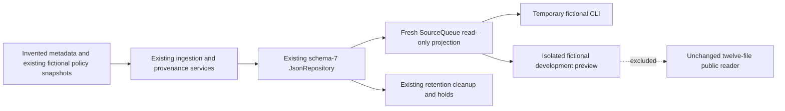

# DL-007A news discovery and source queue validation

Local implementation and deterministic validation on 2026-11-13. No GitHub promotion, hosting operation or real news ingestion is authorized by this milestone.

## Baseline, workspace and preservation

Repository origin is `https://github.com/MauroDot/Dayline.git`. A read-only remote query and non-force fetch verified the approved `main` commit **`0641e47ca44d5000762e7a74b8ad800971632f24`**. The proposed branch/directory were unused. Created `/workspace/Dayline-dl007a`, branch `feature/dl-007a-editorial-source-queue`, from that exact baseline and verified a clean index and working tree. Its source tree matches the accepted W2 development baseline; W2 LF rules and artifact guards are present.

The final SHA is in the completion handoff and `git log -1 --format=%H -- docs/DL-007A_VALIDATION.md`. This report belongs to that implementation commit, avoiding an impossible self-referential hash. Fresh committed artifact manifests separately record their exact commit/tree and clean source provenance.

All sixteen existing worktrees were inventoried and protected, including the fifteen previously protected worktrees plus the completed W2 checkout. The original `/workspace/Dayline` retains its fifteen staged files. Protection compares branch, HEAD, porcelain status, staged/unstaged binary diff hashes, tracked inventory and file-content hashes against `/tmp/dayline-007a-protected-baseline.json`. No reset, stash, clean, renormalization, branch deletion or protected-file rewrite was used.

Shell and managed execution readiness were operational. Exact Node.js **22.16.0**, npm **11.9.0** and TypeScript **5.9.3** were selected. `npm ci` installed the same three pinned development packages; no dependencies or lockfile changed. The command sandbox could not reach its inherited proxy; the approved outer path performed only the authorized Git reads/fetch while retaining proxy/CA trust and destination policy. No GitHub API or Render operation was needed.

## Architecture and data flow



`SourceQueue.read` projects existing `managedSources`, `quarantine`, `sources`, `provenanceDecisions`, permitted deletion markers and the repository retention-review flag. It creates no table, duplicate database, schema migration or persistent queue snapshot. It reuses canonical URL/source identity, strict metadata/timestamp validation, exact captured policy checks, most-restrictive retention deadlines and the existing `eligibleSource` metadata boundary. Reads do not transact, approve, retimestamp, refresh retention or reconstruct redacted source history.

Every output field is explicitly selected. Entries contain an opaque candidate reference, permitted publisher/canonical URL and publication/retrieval timestamps, provenance and rights status, explicit quarantine/retention state, a verified syndication relationship when available, and fixed blocked reasons. No provider body, headline/article payload, credential, private note, policy evidence, reviewer assertion, audit actor or session data is returned.

Views are `RECENT`, `UNRESOLVED`, `RELATED`, `ELIGIBLE`, `BLOCKED` and `WITHDRAWN`. Queries use exact data properties; limit defaults to 20 and is bounded to 1–50. Record/candidate scans are bounded to 10,000; excess or malformed repository shape fails unavailable rather than returning a misleading partial page. Rows sort deterministically by permitted retrieval time then opaque reference. Cursors are bounded and fingerprint the safe projection/view/limit; relevant mutation, rights/retention expiry or changed eligibility rejects a stale cursor without returning cached rows.

## Rights, provenance and retention meanings

- `sourceEligible` means eligible managed **metadata** under the existing newsroom contract. It grants no analysis, AI, redistribution, narration, approval or publication rights. Every entry has `canAdvance: false`.
- Captured rights are compared with the existing private fictional registry. Missing, altered, expired, revoked, superseded or unknown grants never become eligible or inherit stronger current permissions.
- `quarantineStatus` is explicit: `QUARANTINED`, `NOT_QUARANTINED` or `WITHHELD`. Only validated active retained records reveal collection membership. Markers with withheld metadata use `WITHHELD`. A repository review hold may preserve permitted procedural status while denying eligibility.
- Unknown/disputed provenance stays blocked. A provider assertion alone cannot resolve origin. Later disputes or unknown decisions and disputed source verification block eligibility; earlier unknown then valid resolution at the same clock remains supported by authoritative append order.
- Verified syndicated links identify a retained eligible origin; multiple copies are never counted as independent reporting. Unavailable or invalid origins prevent dependent eligibility and withhold unsafe metadata.
- Expiry, deletion, malformed records and inactive rights withhold publisher, URL, source timestamps and relationships. Permitted finite deletion markers remain minimal. Expired/invalid markers are omitted and derive a conservative review hold; reads cannot restore data from audit or revision history.
- Safe tracking parameters/fragments are canonicalized through existing rules. Remaining query-bearing or otherwise unsupported URLs are withheld instead of exposing unfamiliar credential aliases.

Existing duplicate ingestion remains authoritative and preserves its anonymous audit contract. A duplicate attempt does not create another candidate or refresh the original retrieval/retention timestamps. Historical per-candidate duplicate counts cannot be recovered from anonymous outcomes and are not invented. The fixture reports the actual duplicate count from its ingestion call; `RELATED` shows verified syndication relationships.

## Interface and authorization boundary

Current authentication has no source resource kind or source-queue read permission, and its guarded repository adapter rejects arbitrary reads. This milestone therefore uses the assignment's fixture-only inspection option. Real repository queue data has no HTTP endpoint. Existing role/session/resource checks, authenticated editorial mutations and production security policy are unchanged.

The existing source-only development server hosts `/dev/source-queue` and its preview/assets only with `NODE_ENV=development` and `DAYLINE_DEV_SOURCE_QUEUE=fictional`. It requires loopback peers, exact local Host/Origin and safe headers/methods/queries. Staging/production reject development activation variables and never dispatch this handler. No additional listener is opened. The default CLI/source factory creates its own temporary fictional repository; callers cannot select a live repository, source ID, path, provider or credential.

Presentation revalidates its DTO, strips unknown fields and fails closed on invalid combinations. Publisher text is rendered inertly, source links are constrained, and withdrawn/malformed metadata cannot reappear through a forged preview. No-store/CSP headers, focus management, keyboard filters/pagination, explicit loading/empty/unavailable states and a 15-second display lease protect the inspection experience. Expiry/inactivity clears visible and retained browser payload until refresh.

The historical fixture clock is explicitly **2026-06-01T12:00:00.000Z**, within the existing fictional grant. It is not current live rights evidence. Display leases use current browser time independently. No request parameter can choose the authorization/fixture clock. No approval or publication action is offered.

## Fictional demonstration

```bash
npm run source-queue:fixture
NODE_ENV=development DAYLINE_DEV_SOURCE_QUEUE=fictional npm start
# Open http://127.0.0.1:3000/dev/source-queue in the local environment.
```

The zero-argument CLI creates, seeds, reads and removes only its own temporary repository. The actual executed demonstration returned **seven fictional candidates**, **one observed duplicate discovery**, **two eligible managed-metadata records**, **one verified syndicated relationship** and **three metadata-withheld rows**. Cases cover a new unknown candidate, eligible original, disputed provenance, syndicated copy, revoked grant, expired retention and missing rights. Every entry had `canAdvance: false`; no story, edition, approval or publication was created. Repeated seeding tests confirm deduplication without resetting source deadlines.

## Disabled provider review and bounded-response correction

Review found one baseline gap: GNews limited article count and fetch attempts but used unbounded `response.json()` without a whole-body deadline. The narrow correction streams at most **1,048,576 bytes**, checks numeric Content-Length early, validates UTF-8/JSON/schema, and applies the existing **8,000-ms** attempt budget to fetch plus body, including controlled noncooperative test doubles. Discarded/retried/capped/timed-out bodies are cancelled best effort without extending the deadline. Native stream cleanup is tested.

Defaults remain disabled, server-side transport/credentials remain isolated, max articles/page are 10/5, and at most three attempts use the existing 100/200-ms backoff. The configuration defaults object is frozen to prevent accidental mutation of these limits. Network/timeouts and server failures are the only retried categories. Byte/article limits use fixed `RESPONSE_LIMIT_EXCEEDED`, invalid bodies use `MALFORMED_RESPONSE`, and transport/deadline failures use `NETWORK_OR_TIMEOUT`. Raw key-bearing URLs, bodies and exceptions are never emitted by the attempt boundary. All provider tests inject fictional transports; no credential, subscription or live provider request was installed or activated.

## Executed validation

| Check | Actual result |
| --- | --- |
| Locked installation / versions | `npm ci` passed; Node.js **22.16.0**, npm **11.9.0**, TypeScript **5.9.3**, three unchanged development packages. |
| Full CI-equivalent check | `npm run check` passed: TypeScript, all public JavaScript syntax checks and **772/772** backend/domain/security tests; **zero failures, skips or cancellations**, 35.959 seconds. |
| New backend cases | **93** added to the 679-case baseline: 20 queue domain, 37 independent security, 6 fixture/CLI, 9 HTTP/presentation, 3 public isolation and 18 provider-bound cases. All included within 772. |
| Browser regression | **27/27 Chromium tests passed**, 44.850 seconds: existing 18 plus 9 source-queue cases. Zero failures/skips. |
| Accessibility / responsive | Targeted queue axe checks reported zero violations in loaded, empty, unavailable and expired states. Keyboard/filter/pagination/focus, 320/390/768/1440/1920 widths and 2x/4x CSS enlargement/reflow passed; mobile/desktop screenshots inspected. |
| Fictional CLI | Seven candidates, one actual duplicate, one verified syndication link; all `canAdvance: false`; no fetch calls, stories, approvals or publication. Fixture tests also verified temporary cleanup and repeat seeding. |
| Build / reproducibility | Both real precommit artifacts built and inspected; all twelve files and manifests byte-identical, **73,344 bytes** each, pinned Node metadata and unchanged public content digest. |
| Artifact runtime | Staging/SIGTERM and production/SIGINT smoke passed on exact Node22.16, health 200, unknown readiness 503, non-root/read-only execution, route isolation and bounded shutdown; **zero upstream requests**. |
| Source-wrapper startup | Actual CLI startup with an explicit offline fetch guard passed: homepage/style/health 200; readiness 503; disabled queue/edition/internal routes 404; graceful exit 0 and zero upstream attempts. |
| Public/private boundaries | New isolation cases cover queue routes/assets/source/fixture paths unavailable in staging/production, mutation 405, forbidden development activation and exact package inventory/import closure. |
| Whitespace / protection | `git diff --check` passed; all sixteen previous worktrees compared with the retained snapshot, original fifteen staged files preserved. Final post-commit comparison is included in the handoff. |

Executed with exact Node22 selected:

```bash
npm ci
npm run check
PYTHONDONTWRITEBYTECODE=1 python -m unittest discover -s tests/browser -v
npm run source-queue:fixture
npm run build:public
npm run build:public -- --output dist/public-reader-repro
npm run inspect:public
npm run inspect:public -- dist/public-reader-repro
npm run smoke:public
git diff --check
```

The source-wrapper boot check used a temporary child, finite localhost startup checks and a fetch-denying preload; it was stopped and exited cleanly. Full browser runs used deterministic intercepted responses; fixture/provider tests used invented records and injected transports. Source timestamps in the queue are fictional historical inputs, not official API evidence. No news, Treasury, NWS or Render requests were made.

Node's experimental type-stripping warning is expected. The default sandbox denies some localhost/Node-child operations (including empty captured child output and EPERM); complete final suites ran on the approved outer execution path. Direct-file/targeted runs were not substituted for final TAP case totals. Initial new browser assertions were adjusted to actual CSS text/empty-page labeling; the final complete browser run passed. No TypeScript settings, existing tests or platform safeguards were weakened. Strict POSIX/link cases ran on Linux; existing Windows capability-aware skips remain unchanged and are not claimed as passes or a new Windows run.

Session evidence: `/tmp/dayline-007a-install.log`, `...-validation.log`, `...-browser.log`, `...-fixture.log`, `...-fixture-evidence.json`, `...-artifacts.log`, `...-repro-evidence.json`, `...-smoke.log`, `...-development-startup.log` and `...-development-startup-evidence.json`, with prefix `dayline-007a`. Temporary logs may not survive replacement; this committed report preserves actual outcomes. No remote CI was triggered or verified by this local-only task.

## Public runtime and artifacts

The public runtime files, homepage assets, Treasury exact arithmetic/timestamps, NWS identification/attribution, cache/retry/admission limits, fixed-schema operational logging and health/readiness behavior remain unchanged. Queue services, provider code, fixtures, private UI files, tests and the source-only server stay outside the exact twelve-file package. The LF checkout policy and reject-without-normalization guards remain unchanged.

The actual precommit builds record source commit `0641e47ca44d5000762e7a74b8ad800971632f24`, tree `e92c40f9ec8e29291b291e18dcb8139c65017c4f`, `sourceDirty: true` and content digest:

```text
f2742749da68a8035cdb9780e35586cc6b664d95d60e3091b52e4aa9ef922e29
```

This digest matches the accepted R2/W2 public runtime; the new private workflow changes no packaged runtime bytes. Two fresh precommit build directories were compared byte-for-byte, inspected and smoke-tested. Dirty builds remain development evidence. After the local commit, new clean build directories record the exact new SHA/tree, `sourceDirty: false`, file hashes and content digest, with inspection/smoke and offline release-check results in the completion handoff and `/tmp/dayline-007a-final-evidence.json`. These local checks do not verify Render settings or hosted acceptance and grant no deployment or rollback authority.

## Complete changed-file inventory

Exactly **25 files** changed:

```text
README.md
docs/ARCHITECTURE.md
docs/DL-007A_VALIDATION.md
docs/NEWS_PROVIDER_EVALUATION.md
docs/ROADMAP.md
docs/SECURITY_DESIGN.md
fixtures/source-queue-fiction.ts
package.json
public/source-queue.css
public/source-queue.html
public/source-queue.js
server.ts
src/ingestion/gnews.ts
src/source-queue/presentation-types.ts
src/source-queue/presentation.ts
src/source-queue/runner.ts
src/source-queue/service.ts
src/source-queue/types.ts
tests/browser/test_source_queue.py
tests/gnews-bounds.test.ts
tests/source-queue-fixture.test.ts
tests/source-queue-http.test.ts
tests/source-queue-isolation.test.ts
tests/source-queue-security.test.ts
tests/source-queue.test.ts
```

## Limitations and real-source prerequisites

This is an internal development discovery tool, not truth verification, human review, a license or a production editorial console. The repository remains local JSON; it needs durable transactional storage, quotas, monitoring/recovery and cross-system retention/deletion controls. Authenticated source-read permissions, object assignments, current-session checks, revocation handling and exclusive trusted entry points need separately reviewed integration before any real repository browser access. Existing trusted legacy service bypass risks remain production blockers.

Real-source work additionally requires approved commercial/display/attribution terms, original versus syndicated provenance, explicit retention/deletion obligations including backups, derived-summary and AI rights, narration/media rights, server-side credential and cost controls, reviewed provider normalization/URL policies, and independent security/accessibility acceptance. [NEWS_PROVIDER_EVALUATION.md](NEWS_PROVIDER_EVALUATION.md) provides the decision checklist; prospective providers are not described as licensed or approved. Public publishing, real identity providers, unattended scheduling, live ingestion, paid AI/audio and payments remain disabled.

Physical Windows, native zoom and assistive-technology testing remain separate from Linux Chromium and targeted axe checks. Prior Foundation/W2 acceptance remains historical; this milestone does not assert production readiness or formal WCAG/security certification. No Render deployment state or live Treasury/NWS response was queried for this task.

No GitHub push, PR, merge, release/tag, Render deployment/settings/billing/environment/DNS/TLS operation, real news request, live polling, paid AI/audio, production identity, public publication, scheduling or Stripe activation occurred. Stop after the local commit for review.
