# Controlled editorial workflow integration

DL-007D connects the existing source queue, authenticated source review, newsroom story creation and edition services. It uses the existing repository and captures explicit handoff bindings rather than adding a parallel source/story database or publication authority. The public reader and its fictional development preview remain separate.

## End-to-end path

```mermaid
flowchart LR
    A[Discovered fictional source] --> B[Quarantine and authenticated inspection]
    B --> C[Evidence-backed provenance recommendation]
    C --> D[Independent authorized confirmation]
    D --> E[Eligible source selection with exact revisions]
    E --> F[Human-supplied story preparation: INGESTED]
    F --> G[Existing editorial review and separate approval]
    G --> H[Edition assembly: ASSEMBLING]
    H --> I[Separately authorized edition review and readiness]
```

There is no publication step or activated scheduler. Source discovery is metadata, a recommendation is advice, accepted provenance is a controlled source decision, story approval is a separate editorial action and edition readiness is a separate existing operation. None substitutes for the others. An accepted UNKNOWN/DISPUTED decision, missing rights, quarantine or a source/retention hold cannot enter eligible story preparation.

## Existing permissions, exact resources

No permission, role matrix or inferred ownership is introduced.

| Stage | Current role permission | Exact resource requirements |
| --- | --- | --- |
| Source metadata inspection | `SOURCE_READ` | Assigned target; detailed revision/token inspection also requires its complete proof/origin graph. |
| Provenance recommendation | `SOURCE_REVIEW` plus read | Assigned source action and target/proof/origin read grants. |
| Provenance confirmation/rejection | `SOURCE_RESOLVE` plus read | Assigned action and read graph; authenticated identity differs from the proposer. |
| Source hold/release | `SOURCE_HOLD` / `SOURCE_RELEASE` plus read | Exact action/read assignments; release does not clear global retention holds. |
| Handoff selection inspection | `SOURCE_READ` | Every selected source and complete current proof/origin dependency. |
| Story preparation | `STORY_CREATE` and `SOURCE_READ` | Exact preassigned new story ID and complete selected/dependency read graph. |
| Bound story edit/review/approval | Existing `STORY_EDIT` / `STORY_REVIEW` / `STORY_APPROVE`, plus read | Exact story/action/current version and complete current bound source graph. |
| Bound edition assembly | Existing `EDITION_ASSEMBLE`, plus read | Exact date/timezone allocation and each placed story/current version, with its bound source graph. |
| Bound edition review/readiness | Existing `EDITION_REVIEW` / `EDITION_READY`, plus read | Exact edition and contained stories/current revisions, with bound source graphs. |

The existing matrix allows EDITOR/MANAGING_EDITOR to satisfy the read/create conjunction, but each still needs explicit grants. REPORTER has no automatic source read, and ADMINISTRATOR has no automatic editorial creation/approval. Multiple explicitly assigned roles retain their existing union without bypassing provenance separation of duties. Creating or inspecting a story/source grants no later operation or object ownership.

## Eligible selected sources

Selection contains 1–8 unique managed source IDs, each paired with an opaque current 64-hex revision. The complete finite dependency graph is limited to 64 resources; authenticated downstream operations also cap the aggregate graph across participating bound stories at 64. The workflow rejects duplicate/substituted selections and inaccessible proof or syndicated origins.

Every selected source must have current independently confirmed DL-007C RESOLVED provenance and remain eligible under the existing resolver/eligibility rules. Its managed captured policy must be active and permit licensed excerpts, internal analysis and minimal audit, with valid finite retention. Metadata discovery permission alone is insufficient. The policy is captured at ingestion; the handoff cannot upgrade a metadata-only grant, renew retrieval, extend deleteAt or register a real provider. Required proof remains a current eligible VERIFIED managed PRIMARY/ORIGINAL source; syndication retains its verified original identity and cannot fabricate an independent report.

The selected source must also retain matching authenticated SOURCE_REVIEW proposal and SOURCE_RESOLVE confirmation receipts for the exact source/review revisions, actors, times and permissions. A classification or history row alone cannot substitute for that provenance authority. The historical reviewers need not retain their former roles, but receipt loss through bounded retention/capacity fails closed. No receipt is reconstructed or granted automatically; reestablishing provenance requires a separately authorized review workflow and a fresh explicit handoff. Legacy VERIFIED proof sources may support the review without recursively requiring their own DL-007C confirmation, avoiding a circular bootstrap requirement.

DL-007C confirmation does not silently set `Source.verification` to VERIFIED or prove story claims. The handoff preserves that distinction: selected source metadata may retain UNVERIFIED fact-verification status while its independently accepted provenance is current; DISPUTED sources remain blocked. Human evidence claims must be supplied explicitly under the existing story model and undergo separate editorial approval. These local assertions and fixture proofs are not a real-provider or truth certification.

## Human story and immutable binding

The preparation input is `{sources, story}`. Each source selection is `{id, revision}`. The story supplies the existing content fields: id, headline, topic, summary, geography, eventAt, firstSeenAt, updatedAt, clusterId, evidence and sourceIds. Status/version and the private source binding are constructed by trusted code rather than supplied by the caller.

The supplied `story.sourceIds` must exactly match the selected set. Every selected identity must be referenced by supplied evidence. There are 1–16 unique evidence IDs; each explicitly uses VERIFIED state, a nonempty human claim and support references. Support/counterevidence lists are unique, disjoint and confined to the selected identities. Headline/summary/claim/uncertainty bounds are 512/4096/4096/2048 characters. `reviewerDecisions` must be empty so caller prose cannot impersonate authenticated review. The service validates those explicit human inputs; it never creates article text, facts, evidence, uncertainty, verification or approval on the user's behalf.

`buildSourceHandoff` constructs private `sourceHandoff` metadata with trusted `preparedAt`, selected `{id, revision}` tokens and complete dependency tokens. Existing `Newsroom.create` produces one `INGESTED`, version-1 story and its normal audit in the guarded transaction. An optional strictly validated field preserves schema-7 compatibility: old unbound stories/files remain valid, and reading does not manufacture a binding or reinterpret historical assertions as authenticated decisions.

Bindings are immutable through normal edits. Human content may be edited with existing story authority while the captured source state remains valid. Editing source IDs, substituting proof or deleting/replacing a binding cannot silently reauthorize the story. Relevant source/review/proof/rights changes stale the snapshot, including same-clock changes and a hold later released. A new explicit preparation/new story is required; no rebind endpoint is supplied.

## Revision and commit boundary

Selection revisions derive from named authoritative source/review/dependency state, not credentials, caller actor labels or arbitrary private provider extras. A token is a version binding, never a permission. Required relationships and complete dependency identities are discovered from current repository records rather than caller-supplied authorization decisions.

`AuthenticatedSourceHandoff` first verifies the current registered session, role and exact graph assignments. Preparation requires both current source reads and story-create authority, validates the exact supplied source tokens and human story, and invokes existing newsroom creation through the protected repository transaction. Current source/proof eligibility, rights, retention, every bound revision, session/identity/credential status, policy epoch and exact grants are checked again at the commit boundary. Source inspection alone never confers create authority.

Cooperating repository writers serialize on the existing single-host lock. A concurrent source-review change, stale selection, expiry while waiting, revocation, changed role/assignment or failed storage commit denies without a partial prepared story or unauthorized successful receipt. Existing story/edition invalidation and retention scrubbing are reused; unrelated old data is not silently reclassified.

The guard covers trusted synchronous policy/verifier composition and cooperating local transactions. Direct raw repository/legacy service calls, malicious trusted code/files, out-of-band writes, distributed identity changes and multi-host storage remain outside exclusive enforcement. Production requires a reviewed exclusive authorization boundary and durable transactions.

## Private HTTP and response delivery

The existing opt-in development-only loopback listener adds exactly two POST routes:

| Endpoint | Exact body | Safe response |
| --- | --- | --- |
| `/internal/source-handoff/inspect` | `{sourceIds}` — 1–8 unique managed IDs. | Authorized `[{id, revision}]` selections only. |
| `/internal/source-handoff/prepare` | `{sources, story}` — exact selections and separately supplied human story. | `{id, version, status: "INGESTED"}` only. |

Managed IDs use `url-` plus 64 lowercase hexadecimal characters; revision tokens use 64 lowercase hex. Story IDs use the existing safe 128-character HTTP identifier contract. Sources, tokens and content are body fields, never query parameters or paths. Extra actor, authority, policy, status/version and binding fields are rejected by strict validation.

Current loopback/peer, exact Host/Origin, CORS/header/cookie, synthetic bearer and framing restrictions are preserved. Requests require exact JSON content type and declared length, with a 16,384-byte bound and one-second body deadline. The existing source-response ceiling is 262,144 UTF-8 bytes; actual bounded selections and receipts contain no story body, proof list, binding, reviewer identity, policy or provider payload. Fixed failure categories use 400/401/403/409/503 without echoing private values. All responses are no-store.

`withSelection` authorizes fresh guarded token disclosure, and the HTTP callback serializes then calls its final assertion immediately before synchronous send. After accepted preparation, `withPreparedStory` checks the exact current bound INGESTED story version, current `STORY_CREATE` and complete source reads before final safe receipt disclosure. The mutation can already have committed when a later response is denied or disconnected. A failed response is not evidence of rollback; inspect current state through trusted authorized tooling before retrying. Reusing the original story ID fails duplicate creation rather than silently create another version. There is no new public status/login/minting or ownership endpoint, and already submitted bytes cannot be recalled.

## Downstream continuity and retention

Bound newsroom edits and approval transitions, plus edition placement/assembly/review, revalidate current source bindings and eligibility. Authenticated downstream operations additionally require current exact source reads alongside their existing story/edition permissions. Preparation neither changes a story to APPROVED nor makes an edition ready. Edition assembly still requires the exact current approved story revision and captured licensed-content rules.

Source expiry, revocation, deletion, changed provenance/proof or review holds prevent stale approval or edition preparation. Bound edition placements and existing editorial draft contexts cap their content lifetime at the earliest source/proof deadline, without exposing hidden proof attribution. Existing edition/draft invalidation responds to source restrictions; a source hold release cannot refresh a captured story fingerprint. The repository-wide retention-review hold remains authoritative and cannot be cleared by handoff or source review.

Retention redaction follows binding dependencies as well as direct story/evidence links across every historical story version. Removal of a target, proof or origin therefore cannot leave copied source-linked story text in a later revision. Existing whitelist redaction removes private bindings, original source/story identities and licensed prose with existing procedural stubs; action receipts are pruned through the established lifecycle. No new identifying replay database or retention extension is added. Cleanup remains manual logical deletion and cannot erase backups, external copies or unlinked prose.

Existing authenticated legacy creation, editing and downstream progression reject DL-007C review-managed sources in unbound stories to prevent a handoff bypass. Older unbound fixtures and direct trusted legacy services remain for development compatibility and are not retroactively authenticated. Those paths remain a production limitation, not an alternative production entry point.

## Fictional demonstration and acceptance

`npm run editorial-workflow:fixture` accepts no caller repository, credential or live mode. It creates/removes its own fictional repository, uses synthetic identities and a labeled fixed clock, and exercises discovery, inspection, recommendation, independent confirmation, eligible selection and story preparation. Negative examples include disputed metadata, source substitution, revoked sessions and expiry. Story approval remains separate and no edition is published. Only safe deterministic outcomes are printed; no real source or paid service is requested.

The handoff implementation, fixtures and tests remain outside the unchanged twelve-file LF public artifact, whose expected content digest is `f2742749da68a8035cdb9780e35586cc6b664d95d60e3091b52e4aa9ef922e29`. The homepage and Treasury/NWS code are preserved. See [DL-007D validation](DL-007D_VALIDATION.md) for actual test counts, skips, demonstration output and clean artifact evidence; this design document makes no validation-count claim.

Windows physical acceptance, native browser zoom, assistive technology and separately compliant live Treasury/NWS regression remain to be recorded where not executed. Production additionally requires real identity trust/bootstrap/keys, reviewed tenant/assignment lifecycle, exclusive guarded entry points, durable transactional storage, operational clocks/audit/retention, real-provider licensing and independent security review. Historical Foundation development acceptance is not reversed by these production requirements. This local milestone authorizes no GitHub promotion, Render/hosting change, deployment, live provider, production authentication, scheduler, paid AI/audio, payment or public publication.
