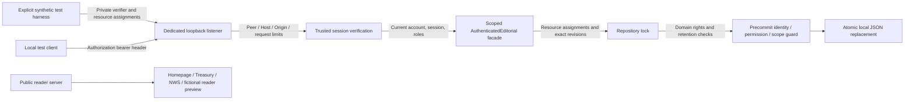

# Dayline — Internal editorial access-control design

DL-005A establishes the internal authentication/authorization foundation; DL-005B connects a restricted subset to a separate, explicitly enabled development HTTP listener. Both use synthetic development identities. They add no real identity provider, public login/admin route, production account or publication permission. Existing homepage, official-data and fictional reader routes retain their behavior. The owner-confirmed historical Foundation 001 development acceptance remains intact; this work does not establish production readiness.

## Trust and stored identity metadata

`TrustedSessionVerifier` is an injected synchronous trust boundary with a fixed issuer, audience and maximum session lifetime. It must validate credential authenticity before returning typed claims. The supplied `SyntheticSessionVerifier` is only a local fixture implementation: strict HS256/HMAC-SHA256 signed credentials, a private 32-byte key held in memory, pinned header/key identity and bounded input. It has no environment/provider adapter or persisted secret. The synthetic compact format is not a production JWT/OIDC implementation. Tests may inject a fixed synthetic key; no real credentials are used.

The repository stores opaque identity IDs, active/disabled status, explicitly assigned roles, provider issuer/subject references, identity revision and credential-version/rotation metadata. Registered sessions store claims metadata and an opaque audit reference, not the signed credential, signature, password, bearer secret or verifier key. Knowing or supplying a user ID is not proof of authentication.

The verifier's default maximum lifetime is 15 minutes, configurable from one second to one hour. Validation enforces issuer/audience, authentication time, not-before, expiry and lifetime without inferring roles from credential text. Future or expired sessions fail closed. Unsigned, tampered, malformed or mismatched credentials cannot become principals. Each protected action also requires an existing matching session, current active identity, nonrevoked session and current credential version.

## Synthetic bootstrap and identity lifecycle

There is no unauthenticated first-administrator registration or production bootstrap/recovery API. `fixtures/security-fiction.ts` explicitly seeds invented identity metadata directly into an isolated temporary repository, then registers a signed synthetic session through the verifier boundary. This fixture composition is trusted test setup, not an account-creation or authentication route.

Internal session registration accepts only an already known issuer/subject and does not self-register identities or assign roles. Operational identity creation, role changes, status changes, credential rotation and administrative session revocation require a current `IDENTITY_ADMIN` authorization. A valid session may also invalidate itself without that administration permission. These operations use the same JSON lock as protected editorial actions. Local storage permits at most 128 identity records and 512 registered sessions; expired sessions are pruned during relevant security operations.

Authorization reads current role/status/session records on every action. Identity administration changes also check the expected identity revision, rejecting stale metadata edits. A role removed before an action's serialized authorization point cannot be recovered from stale credential claims. Disabled identities and revoked sessions are denied. Credential-version rotation immediately invalidates older credential versions; replacement credentials must satisfy the updated registration/version/timing rules. Revocation prevents later use of that registered credential/session, without rewriting the history of actions already validly committed.

## Explicit permission matrix

Permissions from multiple explicitly assigned roles form their union. There is no implicit administrator-to-editor inheritance. `ADMINISTRATOR` alone can manage access and schedules but cannot review or approve editorial content. Assigning another role is an explicit administration action; it is not a permission supplied by a request or object ID.

| Permission | REPORTER | EDITOR | MANAGING_EDITOR | ADMINISTRATOR |
| --- | :---: | :---: | :---: | :---: |
| `STORY_CREATE` | Yes | Yes | Yes | — |
| `STORY_EDIT` | Yes | Yes | Yes | — |
| `STORY_REVIEW` | — | Yes | Yes | — |
| `STORY_APPROVE` | — | — | Yes | — |
| `DRAFT_REVIEW` | — | Yes | Yes | — |
| `DRAFT_READY` | — | — | Yes | — |
| `EDITION_ASSEMBLE` | Yes | Yes | Yes | — |
| `EDITION_REVIEW` | — | Yes | Yes | — |
| `EDITION_READY` | — | — | Yes | — |
| `SCHEDULE_CONFIGURE` | — | — | Yes | Yes |
| `SCHEDULE_EXECUTE` | — | Yes | Yes | Yes |
| `IDENTITY_ADMIN` | — | — | — | Yes |

Unknown permissions and insufficient current roles deny by default. Final story approval, draft readiness and edition readiness use their own permissions rather than a broad review permission. No role has a publishing/distribution permission and no authenticated facade method publishes. Source verification, licensed-content eligibility and existing domain revision/state rules are independent of role membership and still apply. Roles apply within this trusted development workspace. DL-005B additionally requires explicit trusted resource assignments on its HTTP path; production tenant membership and inferred object ownership are not implemented.

| Authenticated command family | Required permission |
| --- | --- |
| Create / edit story | `STORY_CREATE` / `STORY_EDIT` |
| Nonfinal story review | `STORY_REVIEW`; cannot select `APPROVED` or `PUBLISHED`. |
| Approve exact story revision | `STORY_APPROVE` |
| Draft review / ready-for-approval review | `DRAFT_REVIEW` / `DRAFT_READY` |
| Assemble / edit edition | `EDITION_ASSEMBLE` |
| Edition review / ready-for-approval review | `EDITION_REVIEW` / `EDITION_READY` |
| Create / pause / resume schedule | `SCHEDULE_CONFIGURE` |
| Evaluate / claim / begin / prepare / fail / recover runs | `SCHEDULE_EXECUTE` |

Commands select their permission internally; a request does not provide a permission override. Resource IDs identify targets, not actors or authority. The facade and `AccessControl` must refer to the same resolved repository path. All commands still require the corresponding valid domain transition and current expected revision where applicable.

## Protected mutation boundary

`AuthenticatedEditorial` is an internal opt-in facade over existing newsroom, draft review, edition and scheduler operations. DL-005B exposes only selected methods through its private development listener, using a resource-scoped instance. Its guarded repository adapter keeps authorization at the actual mutation boundary:

1. Acquire the existing single-host repository lock and read current state/time.
2. Verify the credential and registered session; check current identity status, credential version, roles and the exact required permission.
3. On the scoped path, authorize the request-bound resources before lifecycle scrubbing, then run the existing domain operation with expected resource revision, state, rights and retention checks.
4. Attach a separate successful-action receipt and bounded safe audit metadata to the candidate state.
5. Sync the complete replacement file, then revalidate the same principal, current permission and scoped resource assignments at the precommit guard before atomic rename.

Role/status/revocation changes serialize through the same lock. An allowed action serialized before a revocation may commit; subsequent actions must use the updated policy. Expiry or revocation detected by the in-lock or precommit check aborts the editorial mutation. Authorization denials leave editorial payload unchanged; sanitized security failure metadata may be recorded separately. A storage failure cannot commit a success receipt without its protected mutation. After initial authorization succeeds, known safe lifecycle invalidations persist even if the requested domain action is rejected. The precommit guard also covers that scrub, so a final authentication failure rolls back editorial changes; initial authentication/permission denials never trigger domain invalidation.

This is a local authorization decision boundary, not a distributed transaction with a real identity provider. A future provider's remote revocation, asynchronous verification, key lifecycle, clock policy and storage trust need a production design and review. The supplied synchronous fixture verifier does not establish those guarantees.

## Authenticated receipts and legacy assertions

Existing direct services continue to support isolated fictional fixtures with caller-supplied actor labels. Historical newsroom approvals, draft/edition reviews and audit labels are not authenticated merely because an ID looks opaque. Migration adds no receipts and relabels no prior action.

A successful resource mutation stores a separate `AuthenticatedAction`: opaque actor ID, identity revision, session audit reference, exact permission, resource kind/ID, resulting resource revision where applicable and timestamp. A bulk operation with no affected resource may record only its safe security event. The receipt distinguishes the new verified synthetic-session path from a legacy assertion. It is not a new rights grant, truth finding, source verification or public publishing token. Existing draft/edition review records may retain their legacy unauthenticated shape; authentication evidence is the separate matching receipt, not a retroactively changed flag.

The facade is opt-in. Trusted code can still instantiate a direct legacy service or modify a JSON repository, so these paths are not a production-wide enforcement boundary. Production mutation entry points would need exclusive, reviewed routing through trusted authorization, real identities and durable storage before exposure.

## Audit and retention

Security events use fixed categories and codes for authentication outcomes, authorization denials, role/status changes, credential rotation, session revocation and protected actions. They retain opaque actor/session/subject references and permission metadata, without raw credentials, provider secrets, source prose, prompts or unbounded exception text. Opaque references minimize exposure but do not establish anonymity.

`securityAudit` and `authenticatedActions` are each capped at 512 records and a seven-day lifetime; pruning occurs during relevant local operations, without a background erasure service. Lifecycle/retention pruning also removes receipts for redacted stories, invalidated drafts/edition revisions, missing resources and failed/cancelled/attention-required runs. It does not create an independent lifetime for licensed source content. Identity/session metadata has its own operational lifecycle and is not covered by a claim that all identity records disappear after seven days.

These bounds intentionally limit historical security evidence; the log is neither complete forever nor tamper-proof. Trusted filesystem/code access can rewrite JSON, and local replacement does not securely erase backups, snapshots or external copies. Existing retention-review holds and content-rights restrictions still apply. Production identity/audit privacy, retention, incident recovery and access policy require separate review.

## Schema migration and isolation

Schema 7 adds `identities`, `sessions`, `securityAudit` and `authenticatedActions`. Reading schemas 1–6 migrates in memory while preserving existing stories, approvals, drafts, editions, schedules and audits. Schema 1/2 keeps the conservative retention hold; schemas 3–6 preserve their existing hold. Reading does not rewrite the file; a successful transaction persists schema 7. New security collections start empty, with no invented identity or authenticated interpretation of legacy assertions.

There are no public authentication, identity-management, editorial mutation or scheduler-control routes. No browser credential store, real provider integration, automatic scheduler, news feed, model/audio request, Stripe action or public publication is activated.

## DL-005B private HTTP trust boundary

The public reader server does not start or import the editorial listener. The development listener is a separate process-local composition, disabled unless explicitly enabled in development mode and unavailable when `NODE_ENV=production`. It binds only IPv4 loopback, uses an ephemeral port by default and checks the peer address, exact bound Host and Origin. The port is not an authentication secret.



Credentials travel only in the `Authorization: Bearer` header over the isolated local test connection. They are never supplied in a URL, cookie, response or log. This is a loopback test transport, not a production TLS deployment. The listener rejects query strings, cookie authentication, forwarding headers, unsupported methods/content types and malformed or oversized bodies. It sends no permissive CORS headers. A same-origin Origin, when present, must match the exact loopback address and port. There is no browser session store or cookie-CSRF security claim; a future browser/cookie design requires a separate CSRF and transport review.

Responses use `Cache-Control: no-store`, fixed safe error categories and server-generated correlation IDs. Neither provider exception text nor incoming request IDs or credentials become error messages. POST requests require exact `application/json` and an explicit Content-Length; chunked transfer is rejected. The body limit is 16,384 bytes with a one-second body deadline. Header size is limited to 12,288 bytes and 48 raw fields; header/request timeouts are configured to five seconds with one-second checking intervals. The listener permits at most 32 concurrent connections, and connections close after one request. These limits are not production rate limiting or denial-of-service guarantees; see the validation report for executed HTTP checks.

`configureIdentityVerifier` selects the trusted verifier through an exact application configuration, never token-supplied issuer metadata or key URLs. It returns a verification-only wrapper around the explicitly configured `SyntheticSessionVerifier`; subclasses and unknown verifier implementations are rejected. `productionProviderVerifier` always denies. The test-only `createEditorialHttpFixture({enabled:true, mode:'development'})` creates a new temporary repository and fresh private signing key for each invocation, returns synthetic credentials only to its in-process caller, and starts no listener by itself. Callers explicitly invoke `startInternalEditorialHTTP({enabled:true, mode:'development', repository, access, policy})`, then close the listener before `dispose()` removes that temporary fixture. The fixture defaults to a fictional epoch advanced by monotonic elapsed time, so manual sessions expire. Tests may explicitly inject a deterministic clock and advance it to exercise expiration. This is not a production clock policy. Only the explicitly configured synthetic development adapter is enabled. The production adapter boundary remains disabled and makes no discovery, OAuth/OIDC, JWKS or remote key requests. Unknown configurations, identities, sessions, key IDs, algorithms, issuers and audiences fail closed. Session revocation, credential rotation and current-role checks remain those of `AccessControl`; no HTTP endpoint registers a session, creates an identity, grants roles or mints credentials.

### Endpoint and permission matrix

Every route below requires a registered, current synthetic session. All paths are on the dedicated listener, under `/internal`; they are absent from the public reader server. JSON bodies accept only the specified top-level fields, with domain validation applied beneath them. Mutation responses contain only allowlisted result identifiers/status/revision metadata, not repository snapshots or source payloads.

| Method and path | Request / permission | Resource binding |
| --- | --- | --- |
| `GET /internal/principal` | Current valid session; returns current opaque identity, roles and permissions. | Authenticated caller only; no identity selector. |
| `POST /internal/session/revoke` | Empty JSON object; current valid session. | Invalidates only the requesting session; no session/identity ID accepted. |
| `POST /internal/stories` | Full fictional story input; `STORY_CREATE`. | Exact preassigned new story ID; no creation implies ownership. |
| `POST /internal/stories/:id/edit` | `{version, patch}`; `STORY_EDIT`. | Assigned story and current expected version. |
| `POST /internal/stories/:id/review` | `{version, status}`; `STORY_REVIEW`. | Assigned story/current version; nonfinal allowed transitions only. |
| `POST /internal/stories/:id/approve` | `{version}`; `STORY_APPROVE`. | Assigned story/current version plus supported, rights-eligible evidence. |
| `POST /internal/editions` | `{date, timezone, placements}`; `EDITION_ASSEMBLE`. | Explicit date/timezone slot and every placed story/current version. |
| `POST /internal/editions/:id/review` | `{revision, status}`; `EDITION_REVIEW` or `EDITION_READY` for readiness. | Exact edition/current revision and contained story assignments. |
| `GET /internal/schedules` | `SCHEDULE_CONFIGURE` or `SCHEDULE_EXECUTE`. | Only explicitly assigned schedules/runs under the corresponding permission; minimal status/fingerprint fields. |
| `POST /internal/schedules/:id/pause` | `{revision}` SHA256 state fingerprint; `SCHEDULE_CONFIGURE`. | Exact assigned schedule/current state; pending runs cancel under normal domain rules. |
| `POST /internal/runs/:id/claim` | `{revision}` SHA256 state fingerprint; `SCHEDULE_EXECUTE`. | Exact assigned run and governing schedule/current run state. No preparation or publication occurs. |

There is no route for provider discovery, credential minting, login, session registration, identity/role administration, AI draft generation, source-rights changes, run preparation or publication. Additional routes are not inferred from exported service methods. Standard failures map to safe 400/401/403/404/405/409/411/413/415/408/503 responses; the response never carries a raw underlying error or credential.

### Explicit resource assignments

`AssignedResourcePolicy` receives trusted assignments for an opaque identity, exact permission and resource kind/ID. At most 1,024 assignments are copied into the immutable policy; the HTTP request cannot provide or extend them. Policy callbacks must complete synchronously and return no value; false/true/Promise results deny. They receive defensive copies of principal, target and state data, so callback mutation cannot rewrite the transaction or its bound targets. There are no wildcard grants and an arbitrary resource ID does not imply ownership. An otherwise authorized role still needs the matching resource assignment. Operations needing unmodeled ownership or assignment semantics are denied.

Story commands bind to the assigned story ID and expected current revision. Edition assembly binds to an explicitly assigned date/timezone slot and to every placed story; reviewing an existing edition binds to that edition and its placements. Schedule pause binds to the assigned schedule and `scheduleRevision` fingerprint of its current state; run claiming binds to both the run/schedule assignments and `runRevision` fingerprint. These SHA256 tokens identify exact procedural state, including changes sharing a timestamp; they are not credentials. Creating an edition grants no inferred right to review its generated ID. Scoped schedule creation/resume, run begin/prepare/fail, bulk recovery and committed evaluation remain denied because those methods do not yet have the required per-object boundary. Current domain rights, provenance, retention holds and eligibility checks remain additional requirements.

Resource authorization runs before lifecycle invalidation and again immediately before commit. Initial role or resource denial cannot scrub unrelated editorial payload. A session revoked while a request is still being received or queued is rejected when it reaches mutation authorization. The dedicated listener also fences a valid own-session revocation request in local memory before awaiting the durable JSON lock. Its scoped commit guard observes that fence, preventing an already in-flight action on the same listener from committing with the fenced session. The fence stores only opaque session IDs/expiry, is capped at 512 entries, and is not a cross-process revocation protocol; a 200 revocation response is sent only after durable invalidation succeeds. Direct internal administration and other cooperating repository transactions still serialize: a revocation committed first prevents the later action; a valid action already committed cannot be retroactively undone by a later revocation. Expiry at the final guard rolls back the candidate mutation and its success receipt. This is a single-host boundary, not atomicity with an external identity provider.

### Legacy bypass inventory

These entries cover paths capable of creating, changing, invalidating or directly writing the relevant approval, readiness, scheduling and identity state. A trusted fixture path is also unsafe for production if exposed without the reviewed authenticated boundary. None is a production administration endpoint.

| Path | Relevant behavior | Classification and HTTP exposure |
| --- | --- | --- |
| `src/security/http.ts` selected routes | Current principal, scoped story/edition commands, scheduler inspection/control, own-session revocation. | **Authenticated**, development-only listener; exact role/resource checks and no caller-selected service dispatch. |
| `src/security/editorial.ts` `createStory`, `editStory`, `reviewStory`, `approveStory`, `reviewDraft`, `assembleEdition`, `editEdition`, `reviewEdition`, `createSchedule`, `pauseSchedule`, `resumeSchedule`, `evaluateSchedules`, `claimRun`, `beginRun`, `prepareRun`, `failRun`, `recoverRuns` | Guarded domain mutations and authenticated receipts. | **Authenticated** internal facade. HTTP uses a resource-scoped instance and only an explicit subset; unsupported scoped methods deny. Direct unscoped composition is trusted development-only and is not production object authorization. |
| `src/security/service.ts` `registerSession`, `createIdentity`, `setRoles`, `setStatus`, `rotateCredentials`, `revokeSession`, `invalidateSession` | Session registration, identity policy, rotation and revocation. | **Authenticated** internal methods. Registration requires a known signed identity; administration needs `IDENTITY_ADMIN`; self-invalidation needs its own valid session. Only self-invalidation is routed over development HTTP. |
| `src/newsroom/service.ts` `create`, `edit`, `transition` | Story revision/status changes, approval records and legacy `PUBLISHED` status. | **Trusted internal development-only; unsafe for production** when called directly. Legacy actor labels grant no identity authority. There is no HTTP path to the direct service or its publication status. |
| `src/editorial/service.ts` `generate`, `review`, `snapshot` | Creates proposals, changes draft readiness, or persists lifecycle invalidation. | **Trusted internal development-only; unsafe for production** when called directly. No HTTP draft-generation/readiness route; `reviewDraft` remains an authenticated internal facade option. |
| `src/editions/service.ts` `createEditionInState`, `EditionService.create`, `edit`, `review`, `snapshot` | Creates/edits edition revisions, changes readiness and persists invalidation. | **Trusted internal development-only; unsafe for production** when called directly. New mutation HTTP routes use the authenticated facade. The fictional reader preview uses only its own disposable fixture. |
| `src/scheduling/service.ts` `create`, `evaluate({dryRun:false})`, `pause`, `resume`, `cancel`, `claim`, `begin`, `prepare`, `fail`, `recover`, `execute`, `snapshot` | Schedule configuration, run coordination, edition preparation and reconciliation. | **Trusted internal development-only; unsafe for production** when called directly. No worker starts automatically. The HTTP adapter exposes only guarded pause and claim; dry-run evaluation works on a copy. |
| `src/editorial/lifecycle.ts` `invalidateDrafts`; `src/editions/lifecycle.ts` `invalidateEditions`; `src/scheduling/lifecycle.ts` `reconcilePreparedRuns` | Revokes readiness, scrubs invalid payload, reconciles prepared runs. | **Trusted internal development-only** lifecycle helpers, called within domain transactions; no direct HTTP dispatch. They never grant readiness or publication. |
| `src/ingestion/retention.ts` `cleanupRetention`; `src/ingestion/history.ts` `redactEditorialHistory` | Removes/redacts historical story approval and linked draft/edition state under retention rules. | **Trusted internal development-only** maintenance; no HTTP endpoint or release-from-hold operation. |
| `src/newsroom/store.ts` `JsonRepository.transact`, `transactGuarded`; direct JSON/filesystem access | Can write any accepted repository state, including identity and approval collections. | **Unsafe for production as an unrestricted entry point**. Trusted local code/storage authority remains outside HTTP enforcement. A guard alone does not make arbitrary raw writes authorized. |
| `fixtures/security-fiction.ts`, `fixtures/editorial-http-fiction.ts`, `fixtures/edition-fiction.ts`, `fixtures/editorial-fiction.ts`; fictional runners in `src/editions/runner.ts`, `src/scheduling/runner.ts` | Seeds identities, source evidence, legacy review assertions and temporary scheduling/edition state for tests. | **Trusted internal development-only** bootstrap in temporary repositories. Credentials exist only in test memory; fixture seeding is not an account-creation endpoint. |
| `server.ts` `/dev/edition/preview` → `src/editions/presentation.ts` `createFictionalDisplaySource`, `displayForEdition` | Lazily seeds a known disposable fictional repository and revalidates/scrubs its preview. | **Trusted internal development-only** scratch lifecycle behind existing mode/peer/Host gates. Read-only caller interface accepts no repository path, resource ID or mutation input. Existing reader behavior is preserved. |
| Public `server.ts` login/admin/editorial/scheduler mutation routes; production provider adapter; publication routes | No implemented public operation. | **Disabled/absent**. Public reader server accepts only GET/HEAD; the private listener has no mint/login, identity administration or publishing endpoint. |

The inventory is not a claim that arbitrary code or filesystem access is confined. Legacy services remain necessary for established fixtures and regression tests. Production requires exclusive authenticated entry points, real identity verification, trusted durable storage and an independent review before any such service is reachable by an untrusted caller.

### Windows acceptance procedure

Use the isolated DL-005B checkout with Node.js 22.16.0 and the pinned dependencies. Run `npm.cmd ci`, `npm.cmd run check` and `npm.cmd run typecheck`; run the Python Chromium suite using the documented local browser prerequisites. Run the targeted suite with `node --experimental-strip-types --test tests/security-http.test.ts tests/security-provider.test.ts tests/security-resources.test.ts tests/security-http-integration.test.ts`. The tests create and close their own loopback listener and temporary repository, with invented credentials kept in memory. Do not copy tokens into a URL, console output, shell history, browser storage or a real account.

Confirm that ordinary `npm.cmd start` exposes only the existing reader routes, that internal authentication/editorial routes remain unavailable there, and that the opt-in fictional reader view still behaves as documented. Check homepage, official-data unavailable states and the fictional edition at the accepted desktop/mobile widths. Record actual outcomes, browser/Node versions and remaining issues. Native 200%/400% browser zoom, keyboard/assistive-technology testing and compliant live Treasury/NWS checks require separate physical execution; automated Chromium results do not establish them. No firewall opening, external listener, real identity provider or production activation is part of this procedure.

## Validation and production requirements

```bash
npm ci
npm run check
npm run typecheck
python -m unittest discover -s tests/browser -v
git diff --check
```

Use only synthetic fixture identities/credentials and the deterministic tests. There is no production login URL or account-creation command. The [DL-005A validation report](DL-005A_VALIDATION.md) records the accepted local baseline, and the [DL-005B validation report](DL-005B_VALIDATION.md) records the current executed checks; mock credentials do not prove real-provider compatibility, actual reviewer identity or production authorization security.

Remaining work includes a reviewed identity-provider trust contract and verification/revocation design, secure production bootstrap/recovery and key management, exclusive authenticated production mutation entry points with reviewed object/tenant policy, durable transactional persistence, operational clock/audit/retention policy, monitoring and independent security review. Editorial licensing, public release and unattended publishing also remain separately blocked. No production service or real account is enabled by this milestone.


## DL-006A release-artifact boundary

The public deployment entry point is `src/public/main.ts`; it does not mount or import the DL-005B private listener. Packaging allowlists only public modules, the official-source/cache adapters and existing public assets, excluding all authenticated and unauthenticated editorial mutation services, fixture runners, local repositories and development edition presentation. This removes privileged code from the inspected runtime artifact instead of relying only on public route names. Running the full repository or modifying trusted artifact files remains outside that boundary.

The public process accepts GET/HEAD only and serves a fixed static/API allowlist with restrictive headers, bounded sockets/concurrency and safe fixed errors/correlation IDs. Unknown/internal/mutation routes cannot select a repository, caller identity, scheduler operation or legacy service. Development edition routes remain a source-checkout facility and are unavailable in staging/production and in the artifact. No public credential minting, account management, production-provider activation or publication authority is added.

Staging/production configuration fails closed for invalid listener values, required NWS identification, incompatible public base URL or forbidden development/synthetic configuration. Operational logs contain whitelisted event/version/status metadata, not contact strings, credentials, request headers/query text or raw provider exceptions. An identifying NWS contact is provided privately in process settings; environment files and real contact details do not enter the package. The local reader cache is bounded and volatile, with health independent of freshness and readiness declining on unknown, failed or stale observed official sources.

An unprivileged account, read-only release files, least-privilege network access, reverse-proxy TLS and external operational controls are deployment responsibilities. An application allowlist does not replace OS isolation, a hosting/security review, production resource limits or accepted licensed editorial publication. The prepared runbook contains a manual authorization gate before any external transfer or deployment, provenance/content inspection, a previous-version recovery procedure and rollback. No automatic deployment from main or external telemetry is enabled. See [DEPLOYMENT_RUNBOOK.md](DEPLOYMENT_RUNBOOK.md) and [DL-006A_VALIDATION.md](DL-006A_VALIDATION.md).


## DL-006B-R2 operational visibility and release safety

The public reader retains its twelve-file allowlist and excludes editorial/authentication/scheduler execution, private repositories, credential fixtures, acceptance harnesses, AI providers, payments and publishing. Operational logging stays inside the existing public entry module; release-check tooling remains outside the runtime package. No diagnostic/admin route, remote telemetry client or provider-control credential is added. Request correlation remains server-generated, and logs expose only fixed schema/category values plus bounded numeric/identity metadata, never raw URLs, contact settings, tokens, headers or upstream response bodies.

Emission limits bound repeated routine records and suppression counters; critical lifecycle categories have a separate finite allowance. Neither logging suppression nor a sink exception changes authorization, data status, health/readiness, retries or cache eligibility. Backpressure drops bounded observations rather than growing a queue. This intentionally loses some operational detail under load, so it is not a durable security audit or a substitute for owner-reviewed incident/retention policy. No outbound monitoring or paid service is activated.

A local release checklist validates candidate identity/integrity and rejects unsafe inputs, but its previous-version identity and disabled-auto-deploy declaration are operator-supplied. A passing offline check cannot establish that Render is healthy, configured as declared or running the claimed artifact; it cannot authorize deployment or automatic rollback. The owner must confirm provider state using existing read-only account access, retain a previous known-good deployment record and obtain separate authorization before any external action. Do not expose a manifest, repository path, settings endpoint or new administration surface to compensate for unavailable provider tooling.

The owner-reported Free staging instance can sleep, and restart discards cache/readiness observations. A cold-start delay or an unknown/upstream-related readiness 503 is not by itself a security failure or rollback decision. The cloud proxy's denied staging connection yielded no reader response; it does not prove a hosted application failure. No Render setting, secret, environment variable, plan, DNS/TLS rule or deployment was changed. Production editorial identity, licensing, storage, publication and independent security review remain separate blocked work.

## DL-007A source-queue boundary

The source queue is a read-only metadata projection, with no approval, provenance-resolution, rights-change, ingestion, publication or release-from-retention-hold operation. Every entry explicitly reports `canAdvance: false`. A valid metadata policy, a provider API result, a source label or a queue view cannot substitute for editorial authority or establish that a claim is true. Verified syndication relationships do not establish independent corroboration.

### Authorization and transport

DL-005A/B defines no source resource kind or source-read permission. DL-007A keeps those interfaces and role/resource matrices unchanged. It does not treat story/edition access, administrator status or an opaque candidate reference as source-read authorization, and adds no queue route to the authenticated listener. The reusable repository projection is trusted local code, like existing repository reads, and is not a production authorization facade.

The browser inspection surface uses only a separately created disposable fictional repository. The existing development server requires exact `NODE_ENV=development` and `DAYLINE_DEV_SOURCE_QUEUE=fictional` opt-in, development reader mode, loopback peer and allowed Host/Origin before serving the page, its assets or data. Host must be an allowed loopback name and actual listener port; a supplied Origin must exactly match. Duplicate sensitive headers, credentials/cookies, forwarding headers, preflight and cross-site requests are rejected. GET/HEAD are the only supported methods. It accepts only bounded queue view/pagination inputs, never a repository path, arbitrary source ID, credential, provider selector or mutation. These local fences do not authenticate an editor; their safety depends on serving only the isolated fictional fixture. No actual newsroom repository is exposed over HTTP. A disabled or unavailable fixture fails closed with a safe unavailable state.

The page renders allowlisted strings as text, offers no automatic external fetch and stores no payload in browser persistence. Responses are not cacheable. Browser display expires after at most 15 seconds of wall-clock time and is cleared on failures and page lifecycle exit. The fixture's fixed historical rights-evaluation time is labeled separately and cannot extend the display lease or authorize current real-source use. Staging/production and the packaged public reader expose no queue page, asset or data endpoint.

### Data minimization and lifecycle

Each queue query reads one fresh atomic repository snapshot and revalidates metadata structure, URLs, timestamps, captured policy identity, current policy status and retained deadlines before forming its display DTO. It never renews a retrieval timestamp or deletion deadline. Revoked, superseded, missing, expired, deleted or malformed metadata is withheld; only fixed safe classifications/reasons and permitted opaque correlation survive. A retention-review hold remains blocking independently of deletion-marker lifetime. Reading cannot remove, release or bypass that hold.

Each entry separately reports `quarantineStatus`: `QUARANTINED` or `NOT_QUARANTINED` only for validated active metadata, otherwise `WITHHELD`. Provenance status cannot substitute for this collection-membership check. A global hold can preserve that known status while blocking all eligibility; an eligible source must be `NOT_QUARANTINED`.

The DTO excludes raw provider responses, tokens/keys, article titles/text/images, private notes, policy payloads, underlying source IDs and audit/reviewer identities. Errors do not echo repository contents or provider exceptions. Relationship references are shown only when verified and safe to disclose. Anonymous duplicate/rejected audits remain anonymous: no URL hash or inferred identity is fabricated to make a related row. Demonstration duplicate counts come from real outcomes of the fictional ingestion run, with no attempt to link historical anonymous attempts.

Stable bounded views and pagination (1–50 entries) prevent unbounded result retrieval. Snapshot fingerprints reject stale continuation after relevant repository or eligibility changes; a fingerprint is a consistency token, not a permission. The projection makes no writes, so inspection cannot grant approval, change policy, refresh retention or race a hidden state transition into existence. Cooperating JSON writers still use the existing atomic replacement/lock model, with its single-host and trusted-filesystem limitations.

### Public packaging and future integration

The twelve-file public-reader allowlist and LF checkout policy remain unchanged. Queue implementation, fixtures, CLI, private interface assets and tests are excluded; the public runtime imports no queue module. Running the full checkout is still a trusted development activity, not a production sandbox. No provider credential, production identity, Render setting, news ingestion, publishing operation, paid API or unattended worker is activated.

A production source-read interface requires explicit source and object/tenant authorization, current-session/role/revocation enforcement at the read boundary, secure production identity/bootstrap, durable storage and independent review. Before any provider is enabled, approve licensing and metadata/display retention, server-only secrets, response limits, provenance, captured policy/deletion deadlines, external-copy deletion and operational controls. The [provider decision checklist](NEWS_PROVIDER_EVALUATION.md#future-source-queue-integration-and-licensing-decision) records these separate prerequisites. [DL-007A validation](DL-007A_VALIDATION.md) records executed local checks and unresolved acceptance work; fictional fixtures do not certify real-provider rights or production authorization.
