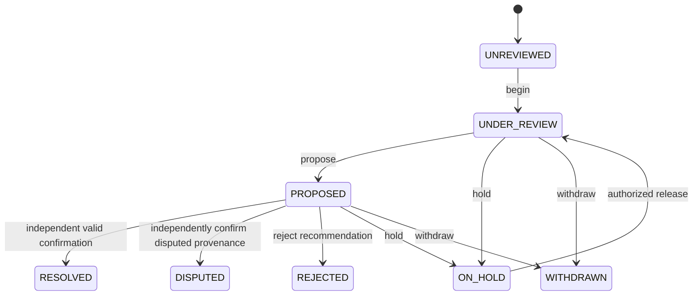

# Controlled source provenance review

DL-007C adds an authenticated development workflow around Dayline's existing retained source records and provenance resolver. It does not add a source database, redefine the provenance classifications, verify a claim's truth or grant public publication rights. The historical Foundation 001 development acceptance remains intact; this workflow does not establish production readiness.

## Authority and resource scope

| Operation | Permission | Roles |
| --- | --- | --- |
| Inspect assigned source metadata/review summary | `SOURCE_READ` | EDITOR, MANAGING_EDITOR |
| Begin review, propose recommendation, withdraw | `SOURCE_REVIEW` | EDITOR, MANAGING_EDITOR |
| Confirm or reject a proposal | `SOURCE_RESOLVE` | MANAGING_EDITOR |
| Place a source review hold | `SOURCE_HOLD` | EDITOR, MANAGING_EDITOR |
| Release a source review hold | `SOURCE_RELEASE` | MANAGING_EDITOR |

Every action additionally requires a valid current registered session, active identity/current credential version, current read permission and exact trusted SOURCE assignments. The action grant names the exact target, and evidence/origin resources require separate read grants. Detailed inspection that returns an action revision token requires read assignments for the target and all transitive pending or accepted evidence/origin dependencies, within the 64-target bound. The basic queue's target-authorized status flags contain no action token and grant no dependency access. A reporter, administrator, editorial role alone or displayed candidate reference cannot confer authority. Trusted policy epoch changes invalidate stale authorization; requests cannot supply policies, assignments, actors or clocks.

Audited source-review mutations are limited to captured active policies with `minimalAudit: true` and a finite positive `auditRetentionDays`, for the target and participating source dependencies. Discovery/metadata-read permission alone cannot authorize storing actor-linked review/evidence history. A no-audit policy therefore cannot enter this mutation workflow; inspection may report `reviewAllowed: false`, while existing `SOURCE_READ` metadata access remains governed by its unchanged read contract. This is a conservative supported subset, not a new license or an upgrade of an old policy snapshot.

The proposer and resolving reviewer must have different authenticated principal identity IDs for confirmation and rejection. Using a second session, rotating credentials or later acquiring a managing-editor role does not make the same individual an independent reviewer. A managing editor may recommend but cannot confirm that same recommendation. These permissions authorize neither story approval nor edition readiness, narration, source editing, rights extension or publication.

## Review states and decisions

The normal path is:

The diagram illustrates the normal path, not every permitted transition or a change to PRIMARY, ORIGINAL, SECONDARY, SYNDICATED, UNKNOWN or DISPUTED provenance. The complete action transitions on a currently reviewable source are:

| Action | Permitted current review state | Result |
| --- | --- | --- |
| `begin` | UNREVIEWED, REJECTED, DISPUTED | UNDER_REVIEW |
| `propose` | UNDER_REVIEW | PROPOSED |
| `confirm` | PROPOSED | RESOLVED for a valid resolved classification; DISPUTED for accepted UNKNOWN/DISPUTED provenance. |
| `reject` | PROPOSED | REJECTED; the rejected recommendation does not replace existing provenance. |
| `hold` | UNREVIEWED, UNDER_REVIEW, PROPOSED, RESOLVED, DISPUTED, REJECTED | ON_HOLD |
| `release` | ON_HOLD | UNDER_REVIEW, with no pending proposal. |
| `withdraw` | UNDER_REVIEW, PROPOSED, RESOLVED, DISPUTED, REJECTED, ON_HOLD | WITHDRAWN; no transition restores this review through `begin`. |

Expired/revoked rights, elapsed retention or deleted/removed source state prevent further review regardless of the stored workflow label. Safe summaries derive EXPIRED or WITHDRAWN restrictions from fresh authoritative records without writing history. Here EXPIRED is a broad current-review-ineligibility category, including a missing audit grant or invalid required proof; it is not a claim that a literal calendar deadline necessarily elapsed. A pending proposal whose target fingerprint or required evidence becomes invalid cannot be confirmed. A recommendation alone changes no source eligibility. Quarantine remains quarantine until separately authorized valid confirmation can use the existing resolution rules; failed or insufficiently supported decisions cannot promote it. Rejection alone does not withdraw a previously eligible managed source; explicit hold/withdrawal and accepted blocking provenance are separate actions.

A proposal binds the exact current source/review revision, a fixed reason code, classification, origin when syndicated and bounded unique evidence references. Evidence references identify retained fictional source records, not arbitrary free-text proof or caller actor assertions. The service checks their existence, permission and current rights/retention. At least one reference must be distinct from the target, and every such non-target proof reference must identify a managed, VERIFIED PRIMARY or ORIGINAL source that remains eligible. The target itself may accompany these references but cannot substitute for independent proof. A syndicated proposal must include its verified original in the evidence list. Confirmation and rejection must supply exactly the pending proposal's evidence set. Missing, malformed, duplicate, inaccessible or insufficient references are rejected. A timestamp and reviewer identity are taken from the trusted clock/current authenticated principal and recorded internally.

| Action | Accepted reason codes |
| --- | --- |
| `begin` | `INITIAL_REVIEW` |
| `propose` resolved classification | `EVIDENCE_SUPPORTED` |
| `propose` DISPUTED | `CONTRADICTORY_EVIDENCE` |
| `propose` UNKNOWN | `INSUFFICIENT_EVIDENCE` |
| `confirm` | `EVIDENCE_SUPPORTED` |
| `reject` | `CONTRADICTORY_EVIDENCE`, `INSUFFICIENT_EVIDENCE` |
| `hold` | `REVIEW_HOLD` |
| `release` | `HOLD_RELEASED` |
| `withdraw` | `WITHDRAWN` |

The code states the asserted procedural reason; it does not prove that evidence is sufficient. A supplied reason cannot bypass classification, current-source or independent-review checks.

Confirmation rechecks the proposal and current authoritative state before applying the existing resolver. A known provider classification cannot be contradicted, prior resolved history cannot be silently rewritten, and SYNDICATED requires an identifiable eligible PRIMARY or ORIGINAL report. A copy shares that original-report identity; review never invents a new independent source. UNKNOWN/DISPUTED decisions do not establish eligibility. Neither recommendation nor confirmation verifies evidence claims or authorizes broader licensed use.

Review holds are explicit source-level restrictions. Releasing one requires a separate permission and does not revive a stale proposal or approve the source. A source review hold is distinct from `retentionReviewRequired`; there is no review endpoint to release the repository-wide retention hold.

## Revision, storage and concurrency

An optional `sourceReviews` history uses the existing schema-7 JSON repository, bounded to 512 stored revisions overall and 64 per source. Exhaustion fails closed rather than silently deleting required history. Existing files without it remain valid. Reading does not manufacture history or reinterpret legacy provider/reviewer assertions as authenticated decisions. Numeric review revisions order the source's history; an opaque exact-state revision token binds mutation inputs to current source, provenance, policy, retention and review state. A pending proposal also binds the authoritative state and review revision/status of its supporting source dependencies. Same-clock evidence rights, provenance or hold changes therefore invalidate the proposal and exact-state token rather than relying only on timestamps. Reviewer identities and arbitrary private extras are not fingerprint inputs. A token identifies a target version and grants no permission.

Every protected action obtains current state under the existing mutation lock, authenticates the registered session/current role, verifies exact source grants and validates revision, lifecycle and separation of duties. Source changes, provenance decisions, review history and successful receipts are constructed as one candidate state and committed through the existing synced-file/atomic-rename transaction. The final guard rechecks current authority and time-sensitive source eligibility. Stale concurrent actions, revoked/expired credentials, policy changes and storage failures fail closed without a partial decision or successful receipt.

A valid accepted resolution keeps the original provider metadata, captured rights snapshot, retention timestamp and deletion deadline. Review input cannot supply replacement policies or deadlines. Accepted source eligibility continues to depend on the required proof after confirmation: a proof hold, loss of verification, expiry or other ineligibility blocks the dependent source and its safe summary. Releasing a restriction or reading a summary never creates a new approval automatically. Applying review holds or accepted blocking decisions revalidates dependent drafts/editions through the existing lifecycle restrictions; it does not grant approval or public distribution.

The guarantees cover cooperating single-host repository writers and trusted synchronous verifier/policy composition. They do not confine arbitrary trusted code, out-of-band file edits, raw repository/legacy service bypasses, asynchronous external identity systems or distributed writers. An action that commits before a revocation remains historical; later requests use the updated authority.

## Visibility and private HTTP

Authorized source-queue metadata may include status, numeric review revision and safe flags for blocked review, pending proposal, independent resolution and whether rights/retention permit review. `reviewAllowed` describes current source/rights/retention availability, not role permission or whether every action is legal in that workflow state; it may remain true during ON_HOLD. `independentlyResolved` describes the latest currently eligible accepted RESOLVED review, not an independent truth finding or an everlasting historical grant. Basic queue flags require the target's read assignment and expose no action token. Detailed inspection returns the opaque action revision token only after authorizing the target and all transitive pending/accepted proof and origin resources. No summary exposes reviewer/proposer identities, evidence references, private decision history or inaccessible origin links. Visibility is filtered before pagination and contributes no hidden candidate counts. Relevant decisions invalidate scoped cursors.

The existing explicitly enabled development-only loopback listener adds these POST operations:

| Path suffix under `/internal/source-review/` | Body |
| --- | --- |
| `inspect` | `{sourceId}` |
| `begin`, `confirm`, `reject`, `hold`, `release`, `withdraw` | `{sourceId, revision, reasonCode, evidenceReferences}` |
| `propose` | Common mutation fields plus `{classification, originId}` |

The route accepts only the fixed action names; the source ID never appears in the URL or query. Managed IDs use `url-` plus 64 lowercase hex characters, revision tokens use 64 lowercase hex characters and evidence lists contain 1–16 unique managed IDs. Fixed reason codes make outcomes auditable without accepting private narrative in errors. Extra actor/assertion, timestamp, policy, retention and authority fields are rejected.

The existing peer, exact Host/Origin, CORS/header/cookie, bearer and content framing restrictions apply. Requests require exact JSON content type and declared length, with a 16,384-byte bound and one-second body deadline. The facade limits safe serialized summaries to 16,384 UTF-8 bytes, within the listener's 262,144-byte source-response ceiling. Fixed failures use 400/401/403/409/503 categories. There is no public login, credential mint, public source approval or publication endpoint.

Inspection and final summary disclosure use fresh guarded authority and a final synchronous response assertion. Mutation commitment and response delivery are distinct: a later disconnect/revocation/disclosure failure cannot roll back an already accepted atomic action. A failed HTTP response alone does not establish rejection; inspect the current revision before retrying. Failures before the commit boundary still persist neither the action nor a successful receipt.

The separate `/dev/source-queue` browser view remains clearly fictional and cannot inspect the authenticated listener's repository. Source review, identities/credentials, private pages and test tooling remain excluded from the unchanged twelve-file public artifact and LF contract.

## Retention, demonstration and remaining work

Review history and receipts do not create independent permission to retain source identities, evidence or actor linkage. Their permitted lifetime ends no later than the earliest applicable source/dependency metadata rights or retention deadline, even if a captured minimal-audit period would otherwise be longer. Local cleanup removes the entire linked identifying history and source receipts when any historical source/evidence/origin reference is removed, expired, revoked or no longer governed; it leaves no identifying digest, actor or evidence replay marker for that history. New authenticated provenance decisions that carry removed evidence links are also removed or minimized, so cleanup covers their copied references rather than only the review collection. Redaction sets the conservative repository-wide retention-review hold and never releases it. This remains manual local cleanup, with no background deletion scheduler or secure-erasure guarantee for filesystems, backups, snapshots, external copies or unlinked prose. Operational deletion enforcement and existing procedural-retention limits remain separate production responsibilities.

`npm run source-review:fixture` creates its own disposable fictional repository, uses synthetic credentials and a labeled fixed clock, demonstrates recommendation/independent confirmation, self-confirmation denial, blocked disputed/insufficient metadata and revocation, then removes temporary state. Story approvals and publication remain unchanged. It accepts no external credential, existing repository or live mode and makes no provider request. See [DL-007C validation](DL-007C_VALIDATION.md) for executed results; this design document makes no test-count claim.

Production remains blocked on real identity trust/revocation, secure bootstrap/key management, reviewed tenant and assignment lifecycle, exclusive authenticated entry points, durable transactional storage, operational clocks/audit/retention, real-source licensing and independent security review. Windows physical acceptance, native browser zoom, assistive technology and separately compliant live Treasury/NWS regression must be recorded where applicable. No GitHub promotion, Render operation, hosting/billing change, deployment, live news ingestion, production identity, paid API, unattended scheduling or publication is activated by this local milestone.
